[English](README.md) · [العربية](i18n/README.ar.md) · [Español](i18n/README.es.md) · [Français](i18n/README.fr.md) · [日本語](i18n/README.ja.md) · [한국어](i18n/README.ko.md) · [Tiếng Việt](i18n/README.vi.md) · [中文 (简体)](i18n/README.zh-Hans.md) · [中文（繁體）](i18n/README.zh-Hant.md) · [Deutsch](i18n/README.de.md) · [Русский](i18n/README.ru.md)

[](https://lazying.art)

# Leonard Susskind Lecture Notes Repository

<!-- reading-languages:start -->
## Books by Language

16 books from the *Theoretical Minimum* and related lectures. [Choose a PDF by book and language](#final-polished-translations), or [open the online PDF reader](https://learn.lazying.art/leonardsusskind-reader.html).

English · 日本語 · 中文（简体） · Français · Español · Deutsch · 中文（繁體） · 한국어 · Tiếng Việt · Русский · العربية

## Read in Bunko

<a href="https://lachlan.lazying.art/Bunko/"></a>

Read on your phone or tablet. The languages you can select depend on the book.

**[App Store](https://apps.apple.com/app/id6815137919)** · **[Google Play](https://play.google.com/store/apps/details?id=art.lazying.bunko)** · [Bunko Web](https://lachlan.lazying.art/Bunko/)

<p>
<a href="https://apps.apple.com/app/id6815137919"></a>
<a href="https://play.google.com/store/apps/details?id=art.lazying.bunko">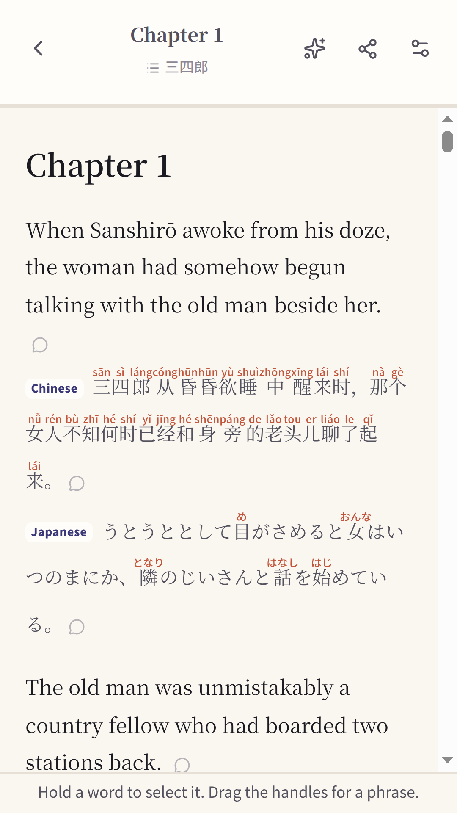</a>
</p>
<!-- reading-languages:end -->

Independent, AI-assisted companion notes with equations, blackboard figures, editable LaTeX, and timestamped transcripts. Transcripts may contain recognition errors. The notes are not official or endorsed. [Source and figure notes](references/editorial_revision_status.md).

Canonical repository: [lachlanchen/leonardsusskind](https://github.com/lachlanchen/leonardsusskind). Transcription tools: [Video2Book](https://github.com/lachlanchen/Video2Book).

## 📚 Published Books

Pocket PDFs: [standard text](all_notes/pocket_books/) · [larger text](all_notes/pocket_books_1_2x/).

<table>
  <tr>
    <td colspan="4"><strong>Core</strong> · Classical → Quantum → Special → General → Statistical → Cosmology</td>
  </tr>
  <tr>
    <td align="center">
      <a href="https://learn.lazying.art/leonardsusskind-reader.html?book=classical-mechanics-theoretical-minimum">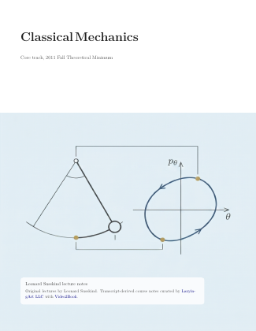</a><br>
      <strong>Classical Mechanics</strong><br>
      <sub>2011 Fall Theoretical Minimum</sub>
      <!-- edition-links --><br><sub><a href="https://learn.lazying.art/leonardsusskind-reader.html?book=classical-mechanics-theoretical-minimum&amp;lang=en">English</a> · <a href="https://learn.lazying.art/leonardsusskind-reader.html?book=classical-mechanics-theoretical-minimum&amp;lang=ja">日本語</a> · <a href="https://learn.lazying.art/leonardsusskind-reader.html?book=classical-mechanics-theoretical-minimum&amp;lang=zh">中文（简体）</a> · <a href="https://learn.lazying.art/leonardsusskind-reader.html?book=classical-mechanics-theoretical-minimum&amp;lang=fr">Français</a> · <a href="https://learn.lazying.art/leonardsusskind-reader.html?book=classical-mechanics-theoretical-minimum&amp;lang=es">Español</a> · <a href="https://learn.lazying.art/leonardsusskind-reader.html?book=classical-mechanics-theoretical-minimum&amp;lang=de">Deutsch</a> · <a href="https://learn.lazying.art/leonardsusskind-reader.html?book=classical-mechanics-theoretical-minimum&amp;lang=zh-Hant">中文（繁體）</a> · <a href="https://learn.lazying.art/leonardsusskind-reader.html?book=classical-mechanics-theoretical-minimum&amp;lang=ko">한국어</a> · <a href="https://learn.lazying.art/leonardsusskind-reader.html?book=classical-mechanics-theoretical-minimum&amp;lang=vi">Tiếng Việt</a> · <a href="https://learn.lazying.art/leonardsusskind-reader.html?book=classical-mechanics-theoretical-minimum&amp;lang=ru">Русский</a></sub><!-- /edition-links -->
    </td>
    <td align="center">
      <a href="https://learn.lazying.art/leonardsusskind-reader.html?book=classical-mechanics-stanford-partial">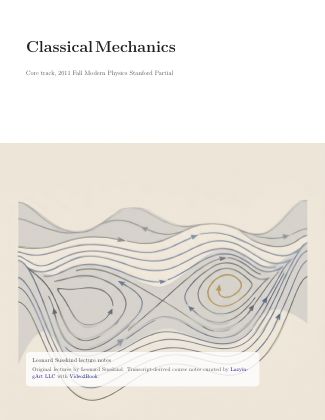</a><br>
      <strong>Classical Mechanics</strong><br>
      <sub>Stanford partial run</sub>
    </td>
    <td align="center">
      <a href="https://learn.lazying.art/leonardsusskind-reader.html?book=quantum-mechanics-theoretical-minimum"></a><br>
      <strong>Quantum Mechanics</strong><br>
      <sub>2012 Winter Theoretical Minimum</sub>
      <!-- edition-links --><br><sub><a href="https://learn.lazying.art/leonardsusskind-reader.html?book=quantum-mechanics-theoretical-minimum&amp;lang=en">English</a> · <a href="https://learn.lazying.art/leonardsusskind-reader.html?book=quantum-mechanics-theoretical-minimum&amp;lang=ja">日本語</a> · <a href="https://learn.lazying.art/leonardsusskind-reader.html?book=quantum-mechanics-theoretical-minimum&amp;lang=zh">中文（简体）</a> · <a href="https://learn.lazying.art/leonardsusskind-reader.html?book=quantum-mechanics-theoretical-minimum&amp;lang=fr">Français</a> · <a href="https://learn.lazying.art/leonardsusskind-reader.html?book=quantum-mechanics-theoretical-minimum&amp;lang=es">Español</a> · <a href="https://learn.lazying.art/leonardsusskind-reader.html?book=quantum-mechanics-theoretical-minimum&amp;lang=de">Deutsch</a> · <a href="https://learn.lazying.art/leonardsusskind-reader.html?book=quantum-mechanics-theoretical-minimum&amp;lang=zh-Hant">中文（繁體）</a> · <a href="https://learn.lazying.art/leonardsusskind-reader.html?book=quantum-mechanics-theoretical-minimum&amp;lang=ko">한국어</a> · <a href="https://learn.lazying.art/leonardsusskind-reader.html?book=quantum-mechanics-theoretical-minimum&amp;lang=vi">Tiếng Việt</a> · <a href="https://learn.lazying.art/leonardsusskind-reader.html?book=quantum-mechanics-theoretical-minimum&amp;lang=ru">Русский</a></sub><!-- /edition-links -->
    </td>
    <td align="center">
      <a href="https://learn.lazying.art/leonardsusskind-reader.html?book=quantum-mechanics-modern-physics-stanford"></a><br>
      <strong>Quantum Mechanics</strong><br>
      <sub>2012 Winter Modern Physics Stanford</sub>
    </td>
  </tr>
  <tr>
    <td align="center">
      <a href="https://learn.lazying.art/leonardsusskind-reader.html?book=special-relativity-theoretical-minimum">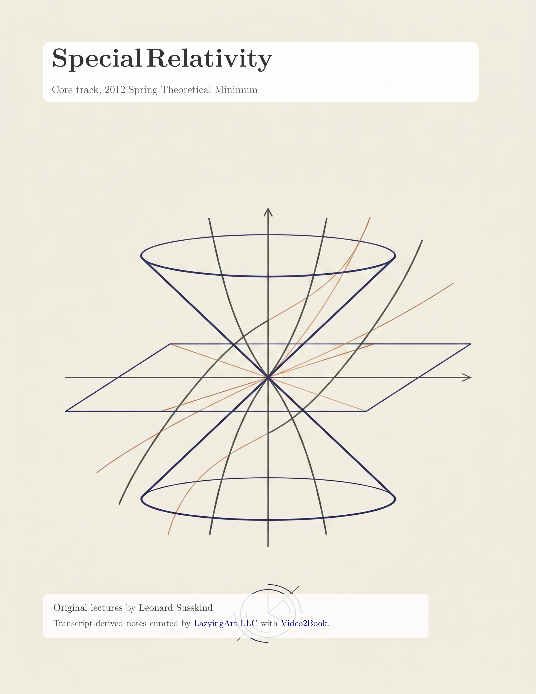</a><br>
      <strong>Special Relativity</strong><br>
      <sub>2012 Spring Theoretical Minimum</sub>
      <!-- edition-links --><br><sub><a href="https://learn.lazying.art/leonardsusskind-reader.html?book=special-relativity-theoretical-minimum&amp;lang=en">English</a> · <a href="https://learn.lazying.art/leonardsusskind-reader.html?book=special-relativity-theoretical-minimum&amp;lang=ja">日本語</a> · <a href="https://learn.lazying.art/leonardsusskind-reader.html?book=special-relativity-theoretical-minimum&amp;lang=zh">中文（简体）</a> · <a href="https://learn.lazying.art/leonardsusskind-reader.html?book=special-relativity-theoretical-minimum&amp;lang=fr">Français</a> · <a href="https://learn.lazying.art/leonardsusskind-reader.html?book=special-relativity-theoretical-minimum&amp;lang=es">Español</a> · <a href="https://learn.lazying.art/leonardsusskind-reader.html?book=special-relativity-theoretical-minimum&amp;lang=de">Deutsch</a> · <a href="https://learn.lazying.art/leonardsusskind-reader.html?book=special-relativity-theoretical-minimum&amp;lang=zh-Hant">中文（繁體）</a> · <a href="https://learn.lazying.art/leonardsusskind-reader.html?book=special-relativity-theoretical-minimum&amp;lang=ko">한국어</a> · <a href="https://learn.lazying.art/leonardsusskind-reader.html?book=special-relativity-theoretical-minimum&amp;lang=vi">Tiếng Việt</a> · <a href="https://learn.lazying.art/leonardsusskind-reader.html?book=special-relativity-theoretical-minimum&amp;lang=ru">Русский</a></sub><!-- /edition-links -->
    </td>
    <td align="center">
      <a href="https://learn.lazying.art/leonardsusskind-reader.html?book=general-relativity-theoretical-minimum">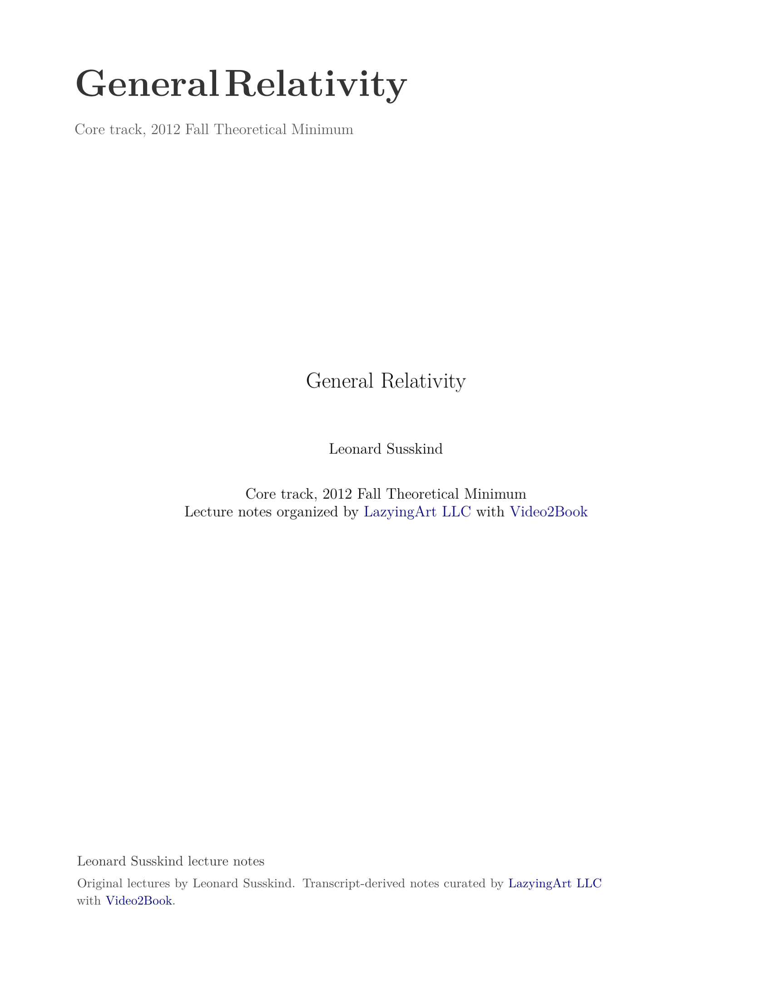</a><br>
      <strong>General Relativity</strong><br>
      <sub>2012 Fall Theoretical Minimum</sub>
      <!-- edition-links --><br><sub><a href="https://learn.lazying.art/leonardsusskind-reader.html?book=general-relativity-theoretical-minimum&amp;lang=en">English</a> · <a href="https://learn.lazying.art/leonardsusskind-reader.html?book=general-relativity-theoretical-minimum&amp;lang=ja">日本語</a> · <a href="https://learn.lazying.art/leonardsusskind-reader.html?book=general-relativity-theoretical-minimum&amp;lang=zh">中文（简体）</a> · <a href="https://learn.lazying.art/leonardsusskind-reader.html?book=general-relativity-theoretical-minimum&amp;lang=fr">Français</a> · <a href="https://learn.lazying.art/leonardsusskind-reader.html?book=general-relativity-theoretical-minimum&amp;lang=es">Español</a> · <a href="https://learn.lazying.art/leonardsusskind-reader.html?book=general-relativity-theoretical-minimum&amp;lang=de">Deutsch</a> · <a href="https://learn.lazying.art/leonardsusskind-reader.html?book=general-relativity-theoretical-minimum&amp;lang=zh-Hant">中文（繁體）</a> · <a href="https://learn.lazying.art/leonardsusskind-reader.html?book=general-relativity-theoretical-minimum&amp;lang=ko">한국어</a> · <a href="https://learn.lazying.art/leonardsusskind-reader.html?book=general-relativity-theoretical-minimum&amp;lang=vi">Tiếng Việt</a> · <a href="https://learn.lazying.art/leonardsusskind-reader.html?book=general-relativity-theoretical-minimum&amp;lang=ru">Русский</a></sub><!-- /edition-links -->
    </td>
    <td align="center">
      <a href="https://learn.lazying.art/leonardsusskind-reader.html?book=general-relativity-einstein-2008">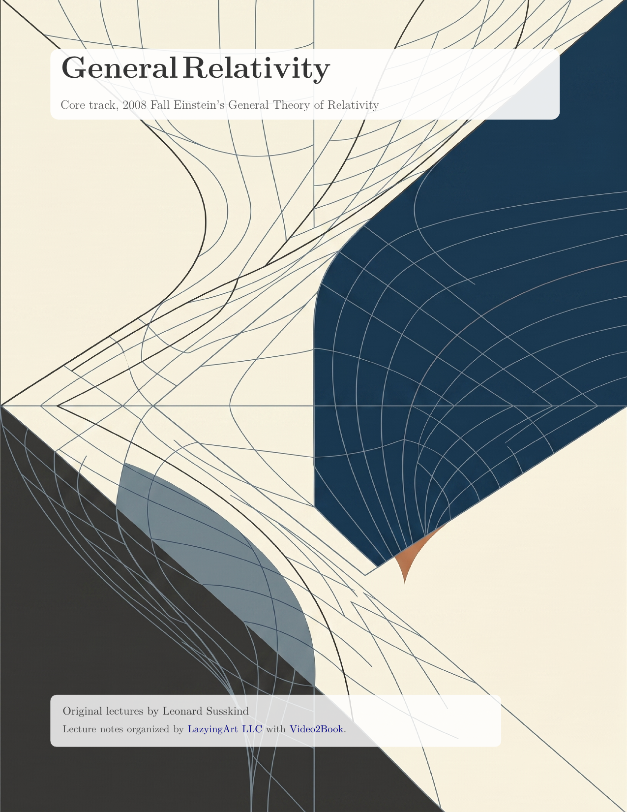</a><br>
      <strong>General Relativity</strong><br>
      <sub>2008 Fall Einstein's General Theory</sub>
    </td>
    <td align="center">
      <a href="https://learn.lazying.art/leonardsusskind-reader.html?book=statistical-mechanics-theoretical-minimum">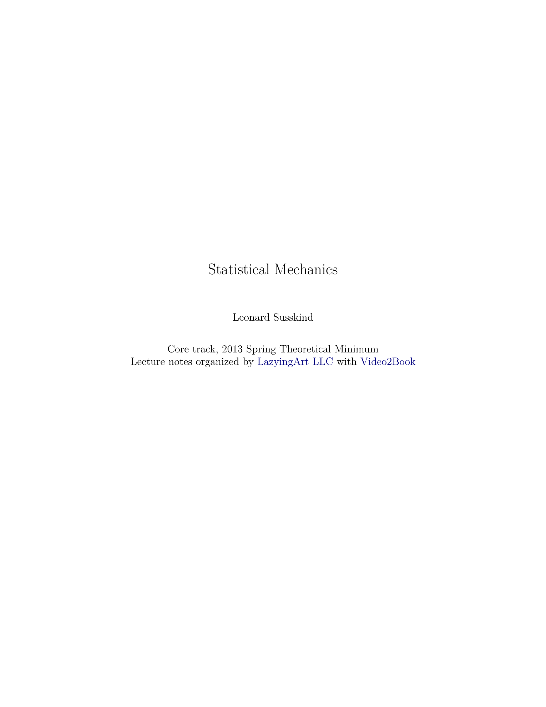</a><br>
      <strong>Statistical Mechanics</strong><br>
      <sub>2013 Spring Theoretical Minimum</sub>
      <!-- edition-links --><br><sub><a href="https://learn.lazying.art/leonardsusskind-reader.html?book=statistical-mechanics-theoretical-minimum&amp;lang=en">English</a> · <a href="https://learn.lazying.art/leonardsusskind-reader.html?book=statistical-mechanics-theoretical-minimum&amp;lang=ja">日本語</a> · <a href="https://learn.lazying.art/leonardsusskind-reader.html?book=statistical-mechanics-theoretical-minimum&amp;lang=zh">中文（简体）</a> · <a href="https://learn.lazying.art/leonardsusskind-reader.html?book=statistical-mechanics-theoretical-minimum&amp;lang=fr">Français</a> · <a href="https://learn.lazying.art/leonardsusskind-reader.html?book=statistical-mechanics-theoretical-minimum&amp;lang=es">Español</a> · <a href="https://learn.lazying.art/leonardsusskind-reader.html?book=statistical-mechanics-theoretical-minimum&amp;lang=de">Deutsch</a> · <a href="https://learn.lazying.art/leonardsusskind-reader.html?book=statistical-mechanics-theoretical-minimum&amp;lang=zh-Hant">中文（繁體）</a> · <a href="https://learn.lazying.art/leonardsusskind-reader.html?book=statistical-mechanics-theoretical-minimum&amp;lang=ko">한국어</a> · <a href="https://learn.lazying.art/leonardsusskind-reader.html?book=statistical-mechanics-theoretical-minimum&amp;lang=vi">Tiếng Việt</a> · <a href="https://learn.lazying.art/leonardsusskind-reader.html?book=statistical-mechanics-theoretical-minimum&amp;lang=ru">Русский</a></sub><!-- /edition-links -->
    </td>
  </tr>
  <tr>
    <td align="center">
      <a href="https://learn.lazying.art/leonardsusskind-reader.html?book=cosmology-theoretical-minimum"></a><br>
      <strong>Cosmology</strong><br>
      <sub>2013 Winter Theoretical Minimum</sub>
      <!-- edition-links --><br><sub><a href="https://learn.lazying.art/leonardsusskind-reader.html?book=cosmology-theoretical-minimum&amp;lang=en">English</a> · <a href="https://learn.lazying.art/leonardsusskind-reader.html?book=cosmology-theoretical-minimum&amp;lang=ja">日本語</a> · <a href="https://learn.lazying.art/leonardsusskind-reader.html?book=cosmology-theoretical-minimum&amp;lang=zh">中文（简体）</a> · <a href="https://learn.lazying.art/leonardsusskind-reader.html?book=cosmology-theoretical-minimum&amp;lang=fr">Français</a> · <a href="https://learn.lazying.art/leonardsusskind-reader.html?book=cosmology-theoretical-minimum&amp;lang=es">Español</a> · <a href="https://learn.lazying.art/leonardsusskind-reader.html?book=cosmology-theoretical-minimum&amp;lang=de">Deutsch</a> · <a href="https://learn.lazying.art/leonardsusskind-reader.html?book=cosmology-theoretical-minimum&amp;lang=zh-Hant">中文（繁體）</a> · <a href="https://learn.lazying.art/leonardsusskind-reader.html?book=cosmology-theoretical-minimum&amp;lang=ko">한국어</a> · <a href="https://learn.lazying.art/leonardsusskind-reader.html?book=cosmology-theoretical-minimum&amp;lang=vi">Tiếng Việt</a> · <a href="https://learn.lazying.art/leonardsusskind-reader.html?book=cosmology-theoretical-minimum&amp;lang=ru">Русский</a></sub><!-- /edition-links -->
    </td>
    <td align="center">
      <a href="https://learn.lazying.art/leonardsusskind-reader.html?book=cosmology-legacy">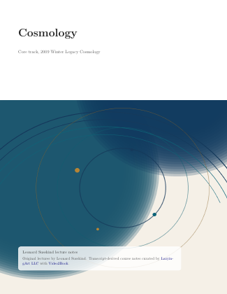</a><br>
      <strong>Cosmology</strong><br>
      <sub>2009 Winter legacy run</sub>
      <!-- edition-links --><br><sub><a href="https://learn.lazying.art/leonardsusskind-reader.html?book=cosmology-legacy&amp;lang=en">English</a> · <a href="https://learn.lazying.art/leonardsusskind-reader.html?book=cosmology-legacy&amp;lang=ja">日本語</a> · <a href="https://learn.lazying.art/leonardsusskind-reader.html?book=cosmology-legacy&amp;lang=zh">中文（简体）</a> · <a href="https://learn.lazying.art/leonardsusskind-reader.html?book=cosmology-legacy&amp;lang=fr">Français</a> · <a href="https://learn.lazying.art/leonardsusskind-reader.html?book=cosmology-legacy&amp;lang=es">Español</a> · <a href="https://learn.lazying.art/leonardsusskind-reader.html?book=cosmology-legacy&amp;lang=de">Deutsch</a> · <a href="https://learn.lazying.art/leonardsusskind-reader.html?book=cosmology-legacy&amp;lang=zh-Hant">中文（繁體）</a> · <a href="https://learn.lazying.art/leonardsusskind-reader.html?book=cosmology-legacy&amp;lang=ko">한국어</a> · <a href="https://learn.lazying.art/leonardsusskind-reader.html?book=cosmology-legacy&amp;lang=vi">Tiếng Việt</a> · <a href="https://learn.lazying.art/leonardsusskind-reader.html?book=cosmology-legacy&amp;lang=ru">Русский</a></sub><!-- /edition-links -->
    </td>
    <td></td>
    <td></td>
  </tr>
  <tr>
    <td colspan="4"><strong>Supplementary</strong> · Quantum · Particle Physics · String Theory · Higgs</td>
  </tr>
  <tr>
    <td align="center">
      <a href="https://learn.lazying.art/leonardsusskind-reader.html?book=advanced-quantum-mechanics">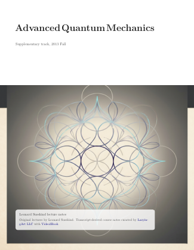</a><br>
      <strong>Advanced Quantum Mechanics</strong><br>
      <sub>Supplementary course book</sub>
      <!-- edition-links --><br><sub><a href="https://learn.lazying.art/leonardsusskind-reader.html?book=advanced-quantum-mechanics&amp;lang=en">English</a> · <a href="https://learn.lazying.art/leonardsusskind-reader.html?book=advanced-quantum-mechanics&amp;lang=ja">日本語</a> · <a href="https://learn.lazying.art/leonardsusskind-reader.html?book=advanced-quantum-mechanics&amp;lang=zh">中文（简体）</a> · <a href="https://learn.lazying.art/leonardsusskind-reader.html?book=advanced-quantum-mechanics&amp;lang=fr">Français</a> · <a href="https://learn.lazying.art/leonardsusskind-reader.html?book=advanced-quantum-mechanics&amp;lang=es">Español</a> · <a href="https://learn.lazying.art/leonardsusskind-reader.html?book=advanced-quantum-mechanics&amp;lang=de">Deutsch</a> · <a href="https://learn.lazying.art/leonardsusskind-reader.html?book=advanced-quantum-mechanics&amp;lang=zh-Hant">中文（繁體）</a> · <a href="https://learn.lazying.art/leonardsusskind-reader.html?book=advanced-quantum-mechanics&amp;lang=ko">한국어</a> · <a href="https://learn.lazying.art/leonardsusskind-reader.html?book=advanced-quantum-mechanics&amp;lang=vi">Tiếng Việt</a> · <a href="https://learn.lazying.art/leonardsusskind-reader.html?book=advanced-quantum-mechanics&amp;lang=ru">Русский</a> · <a href="https://learn.lazying.art/leonardsusskind-reader.html?book=advanced-quantum-mechanics&amp;lang=ar">العربية</a></sub><!-- /edition-links -->
    </td>
    <td align="center">
      <a href="https://learn.lazying.art/leonardsusskind-reader.html?book=quantum-entanglement-part-1">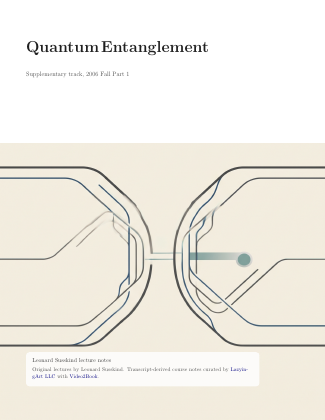</a><br>
      <strong>Quantum Entanglement</strong><br>
      <sub>Part 1</sub>
      <!-- edition-links --><br><sub><a href="https://learn.lazying.art/leonardsusskind-reader.html?book=quantum-entanglement-part-1&amp;lang=en">English</a> · <a href="https://learn.lazying.art/leonardsusskind-reader.html?book=quantum-entanglement-part-1&amp;lang=ja">日本語</a> · <a href="https://learn.lazying.art/leonardsusskind-reader.html?book=quantum-entanglement-part-1&amp;lang=zh">中文（简体）</a> · <a href="https://learn.lazying.art/leonardsusskind-reader.html?book=quantum-entanglement-part-1&amp;lang=fr">Français</a> · <a href="https://learn.lazying.art/leonardsusskind-reader.html?book=quantum-entanglement-part-1&amp;lang=es">Español</a> · <a href="https://learn.lazying.art/leonardsusskind-reader.html?book=quantum-entanglement-part-1&amp;lang=de">Deutsch</a> · <a href="https://learn.lazying.art/leonardsusskind-reader.html?book=quantum-entanglement-part-1&amp;lang=zh-Hant">中文（繁體）</a> · <a href="https://learn.lazying.art/leonardsusskind-reader.html?book=quantum-entanglement-part-1&amp;lang=ko">한국어</a> · <a href="https://learn.lazying.art/leonardsusskind-reader.html?book=quantum-entanglement-part-1&amp;lang=vi">Tiếng Việt</a> · <a href="https://learn.lazying.art/leonardsusskind-reader.html?book=quantum-entanglement-part-1&amp;lang=ru">Русский</a></sub><!-- /edition-links -->
    </td>
    <td align="center">
      <a href="https://learn.lazying.art/leonardsusskind-reader.html?book=quantum-entanglement-part-3">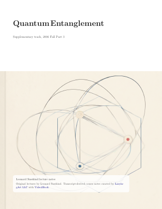</a><br>
      <strong>Quantum Entanglement</strong><br>
      <sub>Part 3</sub>
      <!-- edition-links --><br><sub><a href="https://learn.lazying.art/leonardsusskind-reader.html?book=quantum-entanglement-part-3&amp;lang=en">English</a> · <a href="https://learn.lazying.art/leonardsusskind-reader.html?book=quantum-entanglement-part-3&amp;lang=ja">日本語</a> · <a href="https://learn.lazying.art/leonardsusskind-reader.html?book=quantum-entanglement-part-3&amp;lang=zh">中文（简体）</a> · <a href="https://learn.lazying.art/leonardsusskind-reader.html?book=quantum-entanglement-part-3&amp;lang=fr">Français</a> · <a href="https://learn.lazying.art/leonardsusskind-reader.html?book=quantum-entanglement-part-3&amp;lang=es">Español</a> · <a href="https://learn.lazying.art/leonardsusskind-reader.html?book=quantum-entanglement-part-3&amp;lang=de">Deutsch</a> · <a href="https://learn.lazying.art/leonardsusskind-reader.html?book=quantum-entanglement-part-3&amp;lang=zh-Hant">中文（繁體）</a> · <a href="https://learn.lazying.art/leonardsusskind-reader.html?book=quantum-entanglement-part-3&amp;lang=ko">한국어</a> · <a href="https://learn.lazying.art/leonardsusskind-reader.html?book=quantum-entanglement-part-3&amp;lang=vi">Tiếng Việt</a> · <a href="https://learn.lazying.art/leonardsusskind-reader.html?book=quantum-entanglement-part-3&amp;lang=ru">Русский</a></sub><!-- /edition-links -->
    </td>
  </tr>
  <tr>
    <td align="center">
      <a href="https://learn.lazying.art/leonardsusskind-reader.html?book=particle-physics-1-basic-concepts">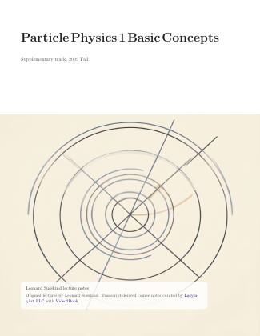</a><br>
      <strong>Particle Physics 1</strong><br>
      <sub>Basic Concepts</sub>
      <!-- edition-links --><br><sub><a href="https://learn.lazying.art/leonardsusskind-reader.html?book=particle-physics-1-basic-concepts&amp;lang=en">English</a> · <a href="https://learn.lazying.art/leonardsusskind-reader.html?book=particle-physics-1-basic-concepts&amp;lang=ja">日本語</a> · <a href="https://learn.lazying.art/leonardsusskind-reader.html?book=particle-physics-1-basic-concepts&amp;lang=zh">中文（简体）</a> · <a href="https://learn.lazying.art/leonardsusskind-reader.html?book=particle-physics-1-basic-concepts&amp;lang=fr">Français</a> · <a href="https://learn.lazying.art/leonardsusskind-reader.html?book=particle-physics-1-basic-concepts&amp;lang=es">Español</a> · <a href="https://learn.lazying.art/leonardsusskind-reader.html?book=particle-physics-1-basic-concepts&amp;lang=de">Deutsch</a> · <a href="https://learn.lazying.art/leonardsusskind-reader.html?book=particle-physics-1-basic-concepts&amp;lang=zh-Hant">中文（繁體）</a> · <a href="https://learn.lazying.art/leonardsusskind-reader.html?book=particle-physics-1-basic-concepts&amp;lang=ko">한국어</a> · <a href="https://learn.lazying.art/leonardsusskind-reader.html?book=particle-physics-1-basic-concepts&amp;lang=vi">Tiếng Việt</a> · <a href="https://learn.lazying.art/leonardsusskind-reader.html?book=particle-physics-1-basic-concepts&amp;lang=ru">Русский</a></sub><!-- /edition-links -->
    </td>
    <td align="center">
      <a href="https://learn.lazying.art/leonardsusskind-reader.html?book=particle-physics-2-standard-model">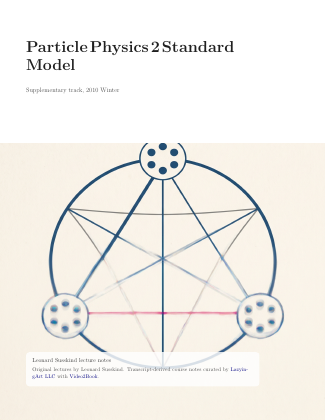</a><br>
      <strong>Particle Physics 2</strong><br>
      <sub>Standard Model</sub>
      <!-- edition-links --><br><sub><a href="https://learn.lazying.art/leonardsusskind-reader.html?book=particle-physics-2-standard-model&amp;lang=en">English</a> · <a href="https://learn.lazying.art/leonardsusskind-reader.html?book=particle-physics-2-standard-model&amp;lang=ja">日本語</a> · <a href="https://learn.lazying.art/leonardsusskind-reader.html?book=particle-physics-2-standard-model&amp;lang=zh">中文（简体）</a> · <a href="https://learn.lazying.art/leonardsusskind-reader.html?book=particle-physics-2-standard-model&amp;lang=fr">Français</a> · <a href="https://learn.lazying.art/leonardsusskind-reader.html?book=particle-physics-2-standard-model&amp;lang=es">Español</a> · <a href="https://learn.lazying.art/leonardsusskind-reader.html?book=particle-physics-2-standard-model&amp;lang=de">Deutsch</a> · <a href="https://learn.lazying.art/leonardsusskind-reader.html?book=particle-physics-2-standard-model&amp;lang=zh-Hant">中文（繁體）</a> · <a href="https://learn.lazying.art/leonardsusskind-reader.html?book=particle-physics-2-standard-model&amp;lang=ko">한국어</a> · <a href="https://learn.lazying.art/leonardsusskind-reader.html?book=particle-physics-2-standard-model&amp;lang=vi">Tiếng Việt</a> · <a href="https://learn.lazying.art/leonardsusskind-reader.html?book=particle-physics-2-standard-model&amp;lang=ru">Русский</a></sub><!-- /edition-links -->
    </td>
    <td align="center">
      <a href="https://learn.lazying.art/leonardsusskind-reader.html?book=particle-physics-3-supersymmetry-and-grand-unification">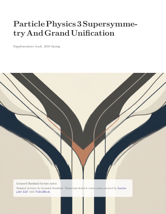</a><br>
      <strong>Particle Physics 3</strong><br>
      <sub>Supersymmetry and Grand Unification</sub>
      <!-- edition-links --><br><sub><a href="https://learn.lazying.art/leonardsusskind-reader.html?book=particle-physics-3-supersymmetry-and-grand-unification&amp;lang=en">English</a> · <a href="https://learn.lazying.art/leonardsusskind-reader.html?book=particle-physics-3-supersymmetry-and-grand-unification&amp;lang=ja">日本語</a> · <a href="https://learn.lazying.art/leonardsusskind-reader.html?book=particle-physics-3-supersymmetry-and-grand-unification&amp;lang=zh">中文（简体）</a> · <a href="https://learn.lazying.art/leonardsusskind-reader.html?book=particle-physics-3-supersymmetry-and-grand-unification&amp;lang=fr">Français</a> · <a href="https://learn.lazying.art/leonardsusskind-reader.html?book=particle-physics-3-supersymmetry-and-grand-unification&amp;lang=es">Español</a> · <a href="https://learn.lazying.art/leonardsusskind-reader.html?book=particle-physics-3-supersymmetry-and-grand-unification&amp;lang=de">Deutsch</a> · <a href="https://learn.lazying.art/leonardsusskind-reader.html?book=particle-physics-3-supersymmetry-and-grand-unification&amp;lang=zh-Hant">中文（繁體）</a> · <a href="https://learn.lazying.art/leonardsusskind-reader.html?book=particle-physics-3-supersymmetry-and-grand-unification&amp;lang=ko">한국어</a> · <a href="https://learn.lazying.art/leonardsusskind-reader.html?book=particle-physics-3-supersymmetry-and-grand-unification&amp;lang=vi">Tiếng Việt</a> · <a href="https://learn.lazying.art/leonardsusskind-reader.html?book=particle-physics-3-supersymmetry-and-grand-unification&amp;lang=ru">Русский</a></sub><!-- /edition-links -->
    </td>
  </tr>
  <tr>
    <td align="center">
      <a href="https://learn.lazying.art/leonardsusskind-reader.html?book=topics-in-string-theory">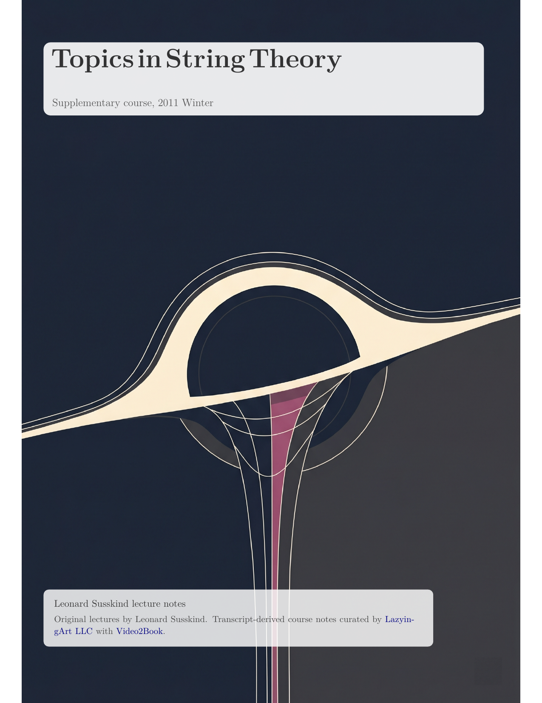</a><br>
      <strong>Topics in String Theory</strong><br>
      <sub>Cosmology and Black Holes set</sub>
      <!-- edition-links --><br><sub><a href="https://learn.lazying.art/leonardsusskind-reader.html?book=topics-in-string-theory&amp;lang=en">English</a> · <a href="https://learn.lazying.art/leonardsusskind-reader.html?book=topics-in-string-theory&amp;lang=ja">日本語</a> · <a href="https://learn.lazying.art/leonardsusskind-reader.html?book=topics-in-string-theory&amp;lang=zh">中文（简体）</a> · <a href="https://learn.lazying.art/leonardsusskind-reader.html?book=topics-in-string-theory&amp;lang=fr">Français</a> · <a href="https://learn.lazying.art/leonardsusskind-reader.html?book=topics-in-string-theory&amp;lang=es">Español</a> · <a href="https://learn.lazying.art/leonardsusskind-reader.html?book=topics-in-string-theory&amp;lang=de">Deutsch</a> · <a href="https://learn.lazying.art/leonardsusskind-reader.html?book=topics-in-string-theory&amp;lang=zh-Hant">中文（繁體）</a> · <a href="https://learn.lazying.art/leonardsusskind-reader.html?book=topics-in-string-theory&amp;lang=ko">한국어</a> · <a href="https://learn.lazying.art/leonardsusskind-reader.html?book=topics-in-string-theory&amp;lang=vi">Tiếng Việt</a> · <a href="https://learn.lazying.art/leonardsusskind-reader.html?book=topics-in-string-theory&amp;lang=ru">Русский</a></sub><!-- /edition-links -->
    </td>
    <td align="center">
      <a href="https://learn.lazying.art/leonardsusskind-reader.html?book=string-theory-and-m-theory">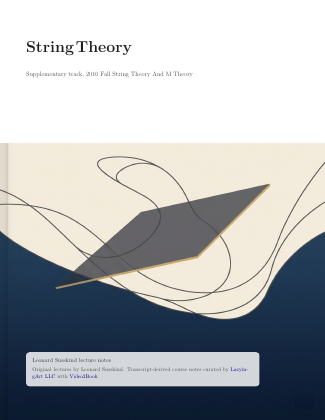</a><br>
      <strong>String Theory and M-Theory</strong><br>
      <sub>Supplementary course book</sub>
      <!-- edition-links --><br><sub><a href="https://learn.lazying.art/leonardsusskind-reader.html?book=string-theory-and-m-theory&amp;lang=en">English</a> · <a href="https://learn.lazying.art/leonardsusskind-reader.html?book=string-theory-and-m-theory&amp;lang=ja">日本語</a> · <a href="https://learn.lazying.art/leonardsusskind-reader.html?book=string-theory-and-m-theory&amp;lang=zh">中文（简体）</a> · <a href="https://learn.lazying.art/leonardsusskind-reader.html?book=string-theory-and-m-theory&amp;lang=fr">Français</a> · <a href="https://learn.lazying.art/leonardsusskind-reader.html?book=string-theory-and-m-theory&amp;lang=es">Español</a> · <a href="https://learn.lazying.art/leonardsusskind-reader.html?book=string-theory-and-m-theory&amp;lang=de">Deutsch</a> · <a href="https://learn.lazying.art/leonardsusskind-reader.html?book=string-theory-and-m-theory&amp;lang=zh-Hant">中文（繁體）</a> · <a href="https://learn.lazying.art/leonardsusskind-reader.html?book=string-theory-and-m-theory&amp;lang=ko">한국어</a> · <a href="https://learn.lazying.art/leonardsusskind-reader.html?book=string-theory-and-m-theory&amp;lang=vi">Tiếng Việt</a> · <a href="https://learn.lazying.art/leonardsusskind-reader.html?book=string-theory-and-m-theory&amp;lang=ru">Русский</a></sub><!-- /edition-links -->
    </td>
    <td align="center">
      <a href="https://learn.lazying.art/leonardsusskind-reader.html?book=demystifying-the-higgs-boson">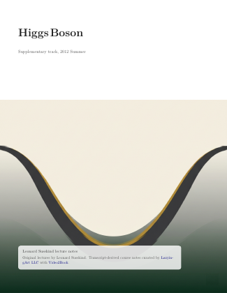</a><br>
      <strong>Demystifying the Higgs Boson</strong><br>
      <sub>Single-lecture book</sub>
      <!-- edition-links --><br><sub><a href="https://learn.lazying.art/leonardsusskind-reader.html?book=demystifying-the-higgs-boson&amp;lang=en">English</a> · <a href="https://learn.lazying.art/leonardsusskind-reader.html?book=demystifying-the-higgs-boson&amp;lang=ja">日本語</a> · <a href="https://learn.lazying.art/leonardsusskind-reader.html?book=demystifying-the-higgs-boson&amp;lang=zh">中文（简体）</a> · <a href="https://learn.lazying.art/leonardsusskind-reader.html?book=demystifying-the-higgs-boson&amp;lang=fr">Français</a> · <a href="https://learn.lazying.art/leonardsusskind-reader.html?book=demystifying-the-higgs-boson&amp;lang=es">Español</a> · <a href="https://learn.lazying.art/leonardsusskind-reader.html?book=demystifying-the-higgs-boson&amp;lang=de">Deutsch</a> · <a href="https://learn.lazying.art/leonardsusskind-reader.html?book=demystifying-the-higgs-boson&amp;lang=zh-Hant">中文（繁體）</a> · <a href="https://learn.lazying.art/leonardsusskind-reader.html?book=demystifying-the-higgs-boson&amp;lang=ko">한국어</a> · <a href="https://learn.lazying.art/leonardsusskind-reader.html?book=demystifying-the-higgs-boson&amp;lang=vi">Tiếng Việt</a> · <a href="https://learn.lazying.art/leonardsusskind-reader.html?book=demystifying-the-higgs-boson&amp;lang=ru">Русский</a> · <a href="https://learn.lazying.art/leonardsusskind-reader.html?book=demystifying-the-higgs-boson&amp;lang=ar">العربية</a></sub><!-- /edition-links -->
    </td>
  </tr>
</table>

## 🗂️ Find the Material

| 📚 Material | 📍 Path | 🧾 Contents |
|---|---|---|
| Full course books | [`all_notes/`](all_notes/) | One merged PDF per available course run, plus `pocket_books/` and larger-type `pocket_books_1_2x/` editions. |
| Published course shelves | `core_*`, `supplemental_*` | Reader-facing PDFs, course READMEs, selected chapter PDFs, and older hand-maintained notes. |
| Editable generated notes | [`generated_course_notes/`](generated_course_notes/) | Lecture TeX, verified frames, audit records, chapter PDFs, and merged course sources. |
| Timestamped transcripts | [`markdown/`](markdown/) | Searchable Markdown transcriptions arranged lecture by lecture. |
| Subtitles | [`subtitles/`](subtitles/) | Matching `.srt` files for the lecture videos. |
| Companion and historical notes | [`theoretical_minimum_companion_notes/`](theoretical_minimum_companion_notes/), [`the_theoretical_minimum/`](the_theoretical_minimum/) | Imported companion TeX, a related source submodule, and older note sets preserved in the published course shelves. |
| Tools and templates | [`Video2Book/`](Video2Book/), [`scripts/`](scripts/), [`template/`](template/) | Playlist download, transcription, note generation, publishing helpers, and LaTeX layouts. |

The transcript, subtitle, and generated-note trees share the same hierarchy: `core/` or `supplementary/`, then subject, course run, and lecture. A generated course normally contains `chapters/`, `figures/`, `course.tex`, and the merged `course.pdf`.

English is the canonical README. Translations are maintained in [`i18n/`](i18n/) and may follow the English revision shortly afterward.

## 🎬 Source Lectures

The main transcription archive follows this YouTube playlist:

- <https://www.youtube.com/playlist?list=PLERGeJGfknBTR_nXt5QL88xJF5LhDZBnG>

## 🚀 Build and Automation

Clone the canonical repository with its submodules:

```bash
git clone --recurse-submodules git@github.com:lachlanchen/leonardsusskind.git
cd leonardsusskind
git submodule update --init --recursive
```

The root wrappers delegate reusable work to the `Video2Book/` submodule:

```bash
# Download or refresh the source playlist.
./scripts/download_susskind_playlist.sh

# Run transcription and its monitor.
./scripts/start_transcription_tmux.sh
./scripts/start_transcription_monitor_tmux.sh

# Curate lecture-by-lecture TeX notes and monitor the queue.
./scripts/start_course_notes_tmux.sh
./scripts/start_course_notes_monitor_tmux.sh

# Export compact 6x9-inch or A5 editions.
./scripts/export_course_pocket_pdfs.sh
./scripts/export_course_pocket_pdfs.sh --size a5 --suffix a5

# Rebuild the imported companion notes.
./theoretical_minimum_companion_notes/build_all.sh
```

## 🤝 Collaboration

Contributions that improve mathematical accuracy, readability, or source preservation are welcome.

- Correct physics terms, speaker attribution, and timestamps in `subtitles/` or `markdown/`.
- Refine derivations, prose, typography, and cross-references in `generated_course_notes/`.
- Verify extracted frames, reconstruct blackboard equations, or redraw diagrams in TikZ.
- Improve provenance and connect related lectures, books, and historical note sets.

Keep each contribution focused, identify the exact course and lecture changed, and include source timestamps or build evidence where relevant.

## 🙏 Acknowledgements

- Leonard Susskind for the original lectures and teaching.
- [LazyingArt LLC](https://lazying.art) for repository curation and publication tooling.
- Simon Crase and the [`weka511/tm`](https://github.com/weka511/tm) project for the imported companion notes.
- La Passerelle and André Cabannes for older [general relativity](https://www.lapasserelle.com/general_relativity/), [cosmology](https://www.lapasserelle.com/cosmology/), and [statistical mechanics](https://www.lapasserelle.com/statistical_mechanics/) note sets preserved here. See the [provenance record](references/lapasserelle_susskind_pdf_provenance.md).

## ❤️ Support

The archive is free. Support is optional.

<!-- support:start -->
[](https://github.com/sponsors/lachlanchen)
[](https://chat.lazying.art/donate)
[](https://paypal.me/RongzhouChen)
[](https://buy.stripe.com/aFadR8gIaflgfQV6T4fw400)
<!-- support:end -->

## License

This repository is licensed under the GNU General Public License v3.0. See [LICENSE](LICENSE).


<!-- polished-translations:start -->
<a name="final-polished-translations"></a>

## PDF Editions

**148/160 translated PDFs published.**

Choose a language to read in your browser. The reader also has a direct PDF link.

| Book | English | 日本語 | 中文（简体） | Français | Español | Deutsch | 中文（繁體） | 한국어 | Tiếng Việt | Русский | العربية |
| --- | --- | --- | --- | --- | --- | --- | --- | --- | --- | --- | --- |
| Demystifying the Higgs Boson (2012 summer) | [Read](https://learn.lazying.art/leonardsusskind-reader.html?book=demystifying-the-higgs-boson&lang=en) | [Read](https://learn.lazying.art/leonardsusskind-reader.html?book=demystifying-the-higgs-boson&lang=ja) | [Read](https://learn.lazying.art/leonardsusskind-reader.html?book=demystifying-the-higgs-boson&lang=zh) | [Read](https://learn.lazying.art/leonardsusskind-reader.html?book=demystifying-the-higgs-boson&lang=fr) | [Read](https://learn.lazying.art/leonardsusskind-reader.html?book=demystifying-the-higgs-boson&lang=es) | [Read](https://learn.lazying.art/leonardsusskind-reader.html?book=demystifying-the-higgs-boson&lang=de) | [Read](https://learn.lazying.art/leonardsusskind-reader.html?book=demystifying-the-higgs-boson&lang=zh-Hant) | [Read](https://learn.lazying.art/leonardsusskind-reader.html?book=demystifying-the-higgs-boson&lang=ko) | [Read](https://learn.lazying.art/leonardsusskind-reader.html?book=demystifying-the-higgs-boson&lang=vi) | [Read](https://learn.lazying.art/leonardsusskind-reader.html?book=demystifying-the-higgs-boson&lang=ru) | [Read](https://learn.lazying.art/leonardsusskind-reader.html?book=demystifying-the-higgs-boson&lang=ar) |
| Advanced Quantum Mechanics (2013 fall) | [Read](https://learn.lazying.art/leonardsusskind-reader.html?book=advanced-quantum-mechanics&lang=en) | [Read](https://learn.lazying.art/leonardsusskind-reader.html?book=advanced-quantum-mechanics&lang=ja) | [Read](https://learn.lazying.art/leonardsusskind-reader.html?book=advanced-quantum-mechanics&lang=zh) | [Read](https://learn.lazying.art/leonardsusskind-reader.html?book=advanced-quantum-mechanics&lang=fr) | [Read](https://learn.lazying.art/leonardsusskind-reader.html?book=advanced-quantum-mechanics&lang=es) | [Read](https://learn.lazying.art/leonardsusskind-reader.html?book=advanced-quantum-mechanics&lang=de) | [Read](https://learn.lazying.art/leonardsusskind-reader.html?book=advanced-quantum-mechanics&lang=zh-Hant) | [Read](https://learn.lazying.art/leonardsusskind-reader.html?book=advanced-quantum-mechanics&lang=ko) | [Read](https://learn.lazying.art/leonardsusskind-reader.html?book=advanced-quantum-mechanics&lang=vi) | [Read](https://learn.lazying.art/leonardsusskind-reader.html?book=advanced-quantum-mechanics&lang=ru) | [Read](https://learn.lazying.art/leonardsusskind-reader.html?book=advanced-quantum-mechanics&lang=ar) |
| Quantum Entanglement Part 1 (2006 fall) | [Read](https://learn.lazying.art/leonardsusskind-reader.html?book=quantum-entanglement-part-1&lang=en) | [Read](https://learn.lazying.art/leonardsusskind-reader.html?book=quantum-entanglement-part-1&lang=ja) | [Read](https://learn.lazying.art/leonardsusskind-reader.html?book=quantum-entanglement-part-1&lang=zh) | [Read](https://learn.lazying.art/leonardsusskind-reader.html?book=quantum-entanglement-part-1&lang=fr) | [Read](https://learn.lazying.art/leonardsusskind-reader.html?book=quantum-entanglement-part-1&lang=es) | [Read](https://learn.lazying.art/leonardsusskind-reader.html?book=quantum-entanglement-part-1&lang=de) | [Read](https://learn.lazying.art/leonardsusskind-reader.html?book=quantum-entanglement-part-1&lang=zh-Hant) | [Read](https://learn.lazying.art/leonardsusskind-reader.html?book=quantum-entanglement-part-1&lang=ko) | [Read](https://learn.lazying.art/leonardsusskind-reader.html?book=quantum-entanglement-part-1&lang=vi) | [Read](https://learn.lazying.art/leonardsusskind-reader.html?book=quantum-entanglement-part-1&lang=ru) | [Read](https://learn.lazying.art/leonardsusskind-reader.html?book=quantum-entanglement-part-1&lang=ar) |
| Quantum Entanglement Part 3 (2006 fall) | [Read](https://learn.lazying.art/leonardsusskind-reader.html?book=quantum-entanglement-part-3&lang=en) | [Read](https://learn.lazying.art/leonardsusskind-reader.html?book=quantum-entanglement-part-3&lang=ja) | [Read](https://learn.lazying.art/leonardsusskind-reader.html?book=quantum-entanglement-part-3&lang=zh) | [Read](https://learn.lazying.art/leonardsusskind-reader.html?book=quantum-entanglement-part-3&lang=fr) | [Read](https://learn.lazying.art/leonardsusskind-reader.html?book=quantum-entanglement-part-3&lang=es) | [Read](https://learn.lazying.art/leonardsusskind-reader.html?book=quantum-entanglement-part-3&lang=de) | [Read](https://learn.lazying.art/leonardsusskind-reader.html?book=quantum-entanglement-part-3&lang=zh-Hant) | [Read](https://learn.lazying.art/leonardsusskind-reader.html?book=quantum-entanglement-part-3&lang=ko) | [Read](https://learn.lazying.art/leonardsusskind-reader.html?book=quantum-entanglement-part-3&lang=vi) | [Read](https://learn.lazying.art/leonardsusskind-reader.html?book=quantum-entanglement-part-3&lang=ru) | [Read](https://learn.lazying.art/leonardsusskind-reader.html?book=quantum-entanglement-part-3&lang=ar) |
| Particle Physics 1: Basic Concepts (2009 fall) | [Read](https://learn.lazying.art/leonardsusskind-reader.html?book=particle-physics-1-basic-concepts&lang=en) | [Read](https://learn.lazying.art/leonardsusskind-reader.html?book=particle-physics-1-basic-concepts&lang=ja) | [Read](https://learn.lazying.art/leonardsusskind-reader.html?book=particle-physics-1-basic-concepts&lang=zh) | [Read](https://learn.lazying.art/leonardsusskind-reader.html?book=particle-physics-1-basic-concepts&lang=fr) | [Read](https://learn.lazying.art/leonardsusskind-reader.html?book=particle-physics-1-basic-concepts&lang=es) | [Read](https://learn.lazying.art/leonardsusskind-reader.html?book=particle-physics-1-basic-concepts&lang=de) | [Read](https://learn.lazying.art/leonardsusskind-reader.html?book=particle-physics-1-basic-concepts&lang=zh-Hant) | [Read](https://learn.lazying.art/leonardsusskind-reader.html?book=particle-physics-1-basic-concepts&lang=ko) | [Read](https://learn.lazying.art/leonardsusskind-reader.html?book=particle-physics-1-basic-concepts&lang=vi) | [Read](https://learn.lazying.art/leonardsusskind-reader.html?book=particle-physics-1-basic-concepts&lang=ru) | In preparation |
| Particle Physics 2: Standard Model (2010 winter) | [Read](https://learn.lazying.art/leonardsusskind-reader.html?book=particle-physics-2-standard-model&lang=en) | [Read](https://learn.lazying.art/leonardsusskind-reader.html?book=particle-physics-2-standard-model&lang=ja) | [Read](https://learn.lazying.art/leonardsusskind-reader.html?book=particle-physics-2-standard-model&lang=zh) | [Read](https://learn.lazying.art/leonardsusskind-reader.html?book=particle-physics-2-standard-model&lang=fr) | [Read](https://learn.lazying.art/leonardsusskind-reader.html?book=particle-physics-2-standard-model&lang=es) | [Read](https://learn.lazying.art/leonardsusskind-reader.html?book=particle-physics-2-standard-model&lang=de) | [Read](https://learn.lazying.art/leonardsusskind-reader.html?book=particle-physics-2-standard-model&lang=zh-Hant) | [Read](https://learn.lazying.art/leonardsusskind-reader.html?book=particle-physics-2-standard-model&lang=ko) | [Read](https://learn.lazying.art/leonardsusskind-reader.html?book=particle-physics-2-standard-model&lang=vi) | [Read](https://learn.lazying.art/leonardsusskind-reader.html?book=particle-physics-2-standard-model&lang=ru) | In preparation |
| Particle Physics 3: Supersymmetry and Grand Unification (2010 spring) | [Read](https://learn.lazying.art/leonardsusskind-reader.html?book=particle-physics-3-supersymmetry-and-grand-unification&lang=en) | [Read](https://learn.lazying.art/leonardsusskind-reader.html?book=particle-physics-3-supersymmetry-and-grand-unification&lang=ja) | [Read](https://learn.lazying.art/leonardsusskind-reader.html?book=particle-physics-3-supersymmetry-and-grand-unification&lang=zh) | [Read](https://learn.lazying.art/leonardsusskind-reader.html?book=particle-physics-3-supersymmetry-and-grand-unification&lang=fr) | [Read](https://learn.lazying.art/leonardsusskind-reader.html?book=particle-physics-3-supersymmetry-and-grand-unification&lang=es) | [Read](https://learn.lazying.art/leonardsusskind-reader.html?book=particle-physics-3-supersymmetry-and-grand-unification&lang=de) | [Read](https://learn.lazying.art/leonardsusskind-reader.html?book=particle-physics-3-supersymmetry-and-grand-unification&lang=zh-Hant) | [Read](https://learn.lazying.art/leonardsusskind-reader.html?book=particle-physics-3-supersymmetry-and-grand-unification&lang=ko) | [Read](https://learn.lazying.art/leonardsusskind-reader.html?book=particle-physics-3-supersymmetry-and-grand-unification&lang=vi) | [Read](https://learn.lazying.art/leonardsusskind-reader.html?book=particle-physics-3-supersymmetry-and-grand-unification&lang=ru) | In preparation |
| Topics in String Theory (2011 winter) | [Read](https://learn.lazying.art/leonardsusskind-reader.html?book=topics-in-string-theory&lang=en) | [Read](https://learn.lazying.art/leonardsusskind-reader.html?book=topics-in-string-theory&lang=ja) | [Read](https://learn.lazying.art/leonardsusskind-reader.html?book=topics-in-string-theory&lang=zh) | [Read](https://learn.lazying.art/leonardsusskind-reader.html?book=topics-in-string-theory&lang=fr) | [Read](https://learn.lazying.art/leonardsusskind-reader.html?book=topics-in-string-theory&lang=es) | [Read](https://learn.lazying.art/leonardsusskind-reader.html?book=topics-in-string-theory&lang=de) | [Read](https://learn.lazying.art/leonardsusskind-reader.html?book=topics-in-string-theory&lang=zh-Hant) | [Read](https://learn.lazying.art/leonardsusskind-reader.html?book=topics-in-string-theory&lang=ko) | [Read](https://learn.lazying.art/leonardsusskind-reader.html?book=topics-in-string-theory&lang=vi) | [Read](https://learn.lazying.art/leonardsusskind-reader.html?book=topics-in-string-theory&lang=ru) | In preparation |
| String Theory and M-Theory (2010 fall) | [Read](https://learn.lazying.art/leonardsusskind-reader.html?book=string-theory-and-m-theory&lang=en) | [Read](https://learn.lazying.art/leonardsusskind-reader.html?book=string-theory-and-m-theory&lang=ja) | [Read](https://learn.lazying.art/leonardsusskind-reader.html?book=string-theory-and-m-theory&lang=zh) | [Read](https://learn.lazying.art/leonardsusskind-reader.html?book=string-theory-and-m-theory&lang=fr) | [Read](https://learn.lazying.art/leonardsusskind-reader.html?book=string-theory-and-m-theory&lang=es) | [Read](https://learn.lazying.art/leonardsusskind-reader.html?book=string-theory-and-m-theory&lang=de) | [Read](https://learn.lazying.art/leonardsusskind-reader.html?book=string-theory-and-m-theory&lang=zh-Hant) | [Read](https://learn.lazying.art/leonardsusskind-reader.html?book=string-theory-and-m-theory&lang=ko) | [Read](https://learn.lazying.art/leonardsusskind-reader.html?book=string-theory-and-m-theory&lang=vi) | [Read](https://learn.lazying.art/leonardsusskind-reader.html?book=string-theory-and-m-theory&lang=ru) | In preparation |
| Classical Mechanics (2011 fall) | [Read](https://learn.lazying.art/leonardsusskind-reader.html?book=classical-mechanics-theoretical-minimum&lang=en) | [Read](https://learn.lazying.art/leonardsusskind-reader.html?book=classical-mechanics-theoretical-minimum&lang=ja) | [Read](https://learn.lazying.art/leonardsusskind-reader.html?book=classical-mechanics-theoretical-minimum&lang=zh) | [Read](https://learn.lazying.art/leonardsusskind-reader.html?book=classical-mechanics-theoretical-minimum&lang=fr) | [Read](https://learn.lazying.art/leonardsusskind-reader.html?book=classical-mechanics-theoretical-minimum&lang=es) | [Read](https://learn.lazying.art/leonardsusskind-reader.html?book=classical-mechanics-theoretical-minimum&lang=de) | [Read](https://learn.lazying.art/leonardsusskind-reader.html?book=classical-mechanics-theoretical-minimum&lang=zh-Hant) | [Read](https://learn.lazying.art/leonardsusskind-reader.html?book=classical-mechanics-theoretical-minimum&lang=ko) | [Read](https://learn.lazying.art/leonardsusskind-reader.html?book=classical-mechanics-theoretical-minimum&lang=vi) | [Read](https://learn.lazying.art/leonardsusskind-reader.html?book=classical-mechanics-theoretical-minimum&lang=ru) | In preparation |
| Quantum Mechanics (2012 winter) | [Read](https://learn.lazying.art/leonardsusskind-reader.html?book=quantum-mechanics-theoretical-minimum&lang=en) | [Read](https://learn.lazying.art/leonardsusskind-reader.html?book=quantum-mechanics-theoretical-minimum&lang=ja) | [Read](https://learn.lazying.art/leonardsusskind-reader.html?book=quantum-mechanics-theoretical-minimum&lang=zh) | [Read](https://learn.lazying.art/leonardsusskind-reader.html?book=quantum-mechanics-theoretical-minimum&lang=fr) | [Read](https://learn.lazying.art/leonardsusskind-reader.html?book=quantum-mechanics-theoretical-minimum&lang=es) | [Read](https://learn.lazying.art/leonardsusskind-reader.html?book=quantum-mechanics-theoretical-minimum&lang=de) | [Read](https://learn.lazying.art/leonardsusskind-reader.html?book=quantum-mechanics-theoretical-minimum&lang=zh-Hant) | [Read](https://learn.lazying.art/leonardsusskind-reader.html?book=quantum-mechanics-theoretical-minimum&lang=ko) | [Read](https://learn.lazying.art/leonardsusskind-reader.html?book=quantum-mechanics-theoretical-minimum&lang=vi) | [Read](https://learn.lazying.art/leonardsusskind-reader.html?book=quantum-mechanics-theoretical-minimum&lang=ru) | In preparation |
| Special Relativity (2012 spring) | [Read](https://learn.lazying.art/leonardsusskind-reader.html?book=special-relativity-theoretical-minimum&lang=en) | [Read](https://learn.lazying.art/leonardsusskind-reader.html?book=special-relativity-theoretical-minimum&lang=ja) | [Read](https://learn.lazying.art/leonardsusskind-reader.html?book=special-relativity-theoretical-minimum&lang=zh) | [Read](https://learn.lazying.art/leonardsusskind-reader.html?book=special-relativity-theoretical-minimum&lang=fr) | [Read](https://learn.lazying.art/leonardsusskind-reader.html?book=special-relativity-theoretical-minimum&lang=es) | [Read](https://learn.lazying.art/leonardsusskind-reader.html?book=special-relativity-theoretical-minimum&lang=de) | [Read](https://learn.lazying.art/leonardsusskind-reader.html?book=special-relativity-theoretical-minimum&lang=zh-Hant) | [Read](https://learn.lazying.art/leonardsusskind-reader.html?book=special-relativity-theoretical-minimum&lang=ko) | [Read](https://learn.lazying.art/leonardsusskind-reader.html?book=special-relativity-theoretical-minimum&lang=vi) | [Read](https://learn.lazying.art/leonardsusskind-reader.html?book=special-relativity-theoretical-minimum&lang=ru) | In preparation |
| General Relativity (2012 fall) | [Read](https://learn.lazying.art/leonardsusskind-reader.html?book=general-relativity-theoretical-minimum&lang=en) | [Read](https://learn.lazying.art/leonardsusskind-reader.html?book=general-relativity-theoretical-minimum&lang=ja) | [Read](https://learn.lazying.art/leonardsusskind-reader.html?book=general-relativity-theoretical-minimum&lang=zh) | [Read](https://learn.lazying.art/leonardsusskind-reader.html?book=general-relativity-theoretical-minimum&lang=fr) | [Read](https://learn.lazying.art/leonardsusskind-reader.html?book=general-relativity-theoretical-minimum&lang=es) | [Read](https://learn.lazying.art/leonardsusskind-reader.html?book=general-relativity-theoretical-minimum&lang=de) | [Read](https://learn.lazying.art/leonardsusskind-reader.html?book=general-relativity-theoretical-minimum&lang=zh-Hant) | [Read](https://learn.lazying.art/leonardsusskind-reader.html?book=general-relativity-theoretical-minimum&lang=ko) | [Read](https://learn.lazying.art/leonardsusskind-reader.html?book=general-relativity-theoretical-minimum&lang=vi) | [Read](https://learn.lazying.art/leonardsusskind-reader.html?book=general-relativity-theoretical-minimum&lang=ru) | In preparation |
| Statistical Mechanics (2013 spring) | [Read](https://learn.lazying.art/leonardsusskind-reader.html?book=statistical-mechanics-theoretical-minimum&lang=en) | [Read](https://learn.lazying.art/leonardsusskind-reader.html?book=statistical-mechanics-theoretical-minimum&lang=ja) | [Read](https://learn.lazying.art/leonardsusskind-reader.html?book=statistical-mechanics-theoretical-minimum&lang=zh) | [Read](https://learn.lazying.art/leonardsusskind-reader.html?book=statistical-mechanics-theoretical-minimum&lang=fr) | [Read](https://learn.lazying.art/leonardsusskind-reader.html?book=statistical-mechanics-theoretical-minimum&lang=es) | [Read](https://learn.lazying.art/leonardsusskind-reader.html?book=statistical-mechanics-theoretical-minimum&lang=de) | [Read](https://learn.lazying.art/leonardsusskind-reader.html?book=statistical-mechanics-theoretical-minimum&lang=zh-Hant) | [Read](https://learn.lazying.art/leonardsusskind-reader.html?book=statistical-mechanics-theoretical-minimum&lang=ko) | [Read](https://learn.lazying.art/leonardsusskind-reader.html?book=statistical-mechanics-theoretical-minimum&lang=vi) | [Read](https://learn.lazying.art/leonardsusskind-reader.html?book=statistical-mechanics-theoretical-minimum&lang=ru) | In preparation |
| Cosmology (2013 winter) | [Read](https://learn.lazying.art/leonardsusskind-reader.html?book=cosmology-theoretical-minimum&lang=en) | [Read](https://learn.lazying.art/leonardsusskind-reader.html?book=cosmology-theoretical-minimum&lang=ja) | [Read](https://learn.lazying.art/leonardsusskind-reader.html?book=cosmology-theoretical-minimum&lang=zh) | [Read](https://learn.lazying.art/leonardsusskind-reader.html?book=cosmology-theoretical-minimum&lang=fr) | [Read](https://learn.lazying.art/leonardsusskind-reader.html?book=cosmology-theoretical-minimum&lang=es) | [Read](https://learn.lazying.art/leonardsusskind-reader.html?book=cosmology-theoretical-minimum&lang=de) | [Read](https://learn.lazying.art/leonardsusskind-reader.html?book=cosmology-theoretical-minimum&lang=zh-Hant) | [Read](https://learn.lazying.art/leonardsusskind-reader.html?book=cosmology-theoretical-minimum&lang=ko) | [Read](https://learn.lazying.art/leonardsusskind-reader.html?book=cosmology-theoretical-minimum&lang=vi) | [Read](https://learn.lazying.art/leonardsusskind-reader.html?book=cosmology-theoretical-minimum&lang=ru) | In preparation |
| Cosmology (2009 winter) | [Read](https://learn.lazying.art/leonardsusskind-reader.html?book=cosmology-legacy&lang=en) | [Read](https://learn.lazying.art/leonardsusskind-reader.html?book=cosmology-legacy&lang=ja) | [Read](https://learn.lazying.art/leonardsusskind-reader.html?book=cosmology-legacy&lang=zh) | [Read](https://learn.lazying.art/leonardsusskind-reader.html?book=cosmology-legacy&lang=fr) | [Read](https://learn.lazying.art/leonardsusskind-reader.html?book=cosmology-legacy&lang=es) | [Read](https://learn.lazying.art/leonardsusskind-reader.html?book=cosmology-legacy&lang=de) | [Read](https://learn.lazying.art/leonardsusskind-reader.html?book=cosmology-legacy&lang=zh-Hant) | [Read](https://learn.lazying.art/leonardsusskind-reader.html?book=cosmology-legacy&lang=ko) | [Read](https://learn.lazying.art/leonardsusskind-reader.html?book=cosmology-legacy&lang=vi) | [Read](https://learn.lazying.art/leonardsusskind-reader.html?book=cosmology-legacy&lang=ru) | In preparation |

[Edition notes](references/POLISHED_TRANSLATIONS.md)
<!-- polished-translations:end -->

<!-- reading-citation:start -->
## Citation and Support

Cite these independent companion notes, not the original lectures:

[CITATION.cff](CITATION.cff) · [GitHub Sponsors](https://github.com/sponsors/lachlanchen)

```bibtex
@software{lazyingart_susskind_companion_notes,
  author = {{LazyingArt contributors}},
  title = {Leonard Susskind Lecture Notes: Independent Multilingual Companion Editions},
  url = {https://github.com/lachlanchen/leonardsusskind}
}
```
<!-- reading-citation:end -->
