[English](../README.md) · [العربية](README.ar.md) · [Español](README.es.md) · [Français](README.fr.md) · [日本語](README.ja.md) · [한국어](README.ko.md) · [Tiếng Việt](README.vi.md) · [中文 (简体)](README.zh-Hans.md) · [中文（繁體）](README.zh-Hant.md) · [Deutsch](README.de.md) · [Русский](README.ru.md)

[](https://lazying.art)

# Repository für Leonard-Susskind-Vorlesungsnotizen

<!-- reading-languages:start -->
## Auf Englisch, Japanisch und Chinesisch lesen

Für 16 abschließend redigierte Bücher sind japanische und vereinfachte chinesische Ausgaben neben den englischen Originalen verfügbar. PDFs sind eigenständige Sprachausgaben; Bunko bietet ausgerichtete Sprachebenen.

Neue übersetzte PDFs verwenden 177.6 × 252 mm (beide A5-Seiten × 1.2), 12 pt Schrift und erhalten Formeln und Abbildungen. Das ältere „pocket 1.2x“ bezeichnet größere Schrift, nicht dieses Papierformat.

Wir erweitern die mehrsprachige Bibliothek. Beiträge zu weiteren Sprachen, Physik-Korrekturlesen, Barrierefreiheit und Layout sind willkommen. Bitte ein Issue oder eine belegte Korrektur einreichen. Weitere Sprachen sind geplant, noch nicht veröffentlicht.

[Bunko](https://lachlan.lazying.art/Bunko/) · [LazyLearn](https://learn.lazying.art/leonardsusskind-reader.html) · [GitHub Issues](https://github.com/lachlanchen/leonardsusskind/issues)
<!-- reading-languages:end -->

> Geleitet von [LazyingArt LLC](https://lazying.art). Websites: [lazying.art](https://lazying.art) und [learn.lazying.art](https://learn.lazying.art).

[](#)
[](#-repo-layout)
[](#-repo-layout)
[](#-repo-layout)
[](#-repo-layout)
[](#)

Dieses Repository ist ein Physik-Studienarchiv mit Schwerpunkt auf den Vorlesungen von Leonard Susskind, dem breiteren *Theoretical Minimum*-Ökosystem und aus Transkripten abgeleiteten Begleitnotizen.

Es kombiniert Vorlesungstranskriptionen, Untertiteldateien, generierte TeX-Notizen, kompilierte PDFs und manuell gepflegte Kursordner in einer stabilen Verzeichnisstruktur.

> 📘 Vollständige Vorlesungstranskriptionen, Untertiteldateien, Workflows für generierte TeX-Notizen und veröffentlichte Kurs-PDFs werden hier in einem einzigen Archiv gepflegt.
>
> 🛠️ Die hier verwendete Automatisierung für Download, Transkription und die Umwandlung von Untertiteln in Notizen wird im begleitenden Tool-Repository [Video2Book](https://github.com/lachlanchen/Video2Book) gepflegt, das in diesem Repository als Submodul `Video2Book/` enthalten ist.

> **Hinweis zur Ausgabe:** Die zeitgestempelten Transkripte wurden maschinell erzeugt und können Erkennungsfehler enthalten. Die kompilierten Bücher sind unabhängig redigierte, KI-gestützte Begleitnotizen, die aus Transkripten und Tafelbildern rekonstruiert wurden; sie sind weder wortgetreue Transkripte noch Originalmanuskripte oder von Leonard Susskind gebilligte Ausgaben. Die laufende [redaktionelle Überarbeitung](../references/editorial_revision_status.md) dokumentiert Quellen und Abbildungen kapitelweise.

## 📚 Veröffentlichte Bücher

> 📷 Die Vorschaubilder der Cover stammen jeweils von der ersten Seite des zugehörigen Kurs-PDFs, damit das Root-README und die Website-Karten immer exakt zum tatsächlich veröffentlichten Text und Layout passen.
>
> 📱 Für abgeschlossene Bücher werden auch Pocket-size-/Penguin-Ausgaben veröffentlicht:
> [Pocket-size 1.0x](../all_notes/pocket_books/) und [Pocket-size 1.2x](../all_notes/pocket_books_1_2x/).
> Diese kompakten Builds sind auf komfortables Lesen auf 10-Zoll-E-Ink-Geräten und Bildschirmen der iPad-Klasse abgestimmt.

<table>
  <tr>
    <td colspan="4"><strong>Kern</strong> · Klassisch → Quanten → Speziell → Allgemein → Statistisch → Kosmologie</td>
  </tr>
  <tr>
    <td align="center">
      <a href="https://learn.lazying.art/leonardsusskind-reader.html?book=classical-mechanics-theoretical-minimum">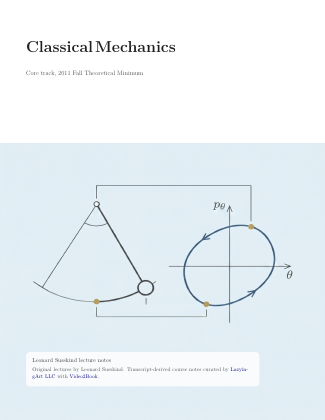</a><br>
      <strong>Klassische Mechanik</strong><br>
      <sub>Herbst 2011 Theoretical Minimum</sub>
      <!-- edition-links --><br><sub><a href="https://learn.lazying.art/leonardsusskind-reader.html?book=classical-mechanics-theoretical-minimum&amp;lang=en">English</a> · <a href="https://learn.lazying.art/leonardsusskind-reader.html?book=classical-mechanics-theoretical-minimum&amp;lang=ja">日本語</a> · <a href="https://learn.lazying.art/leonardsusskind-reader.html?book=classical-mechanics-theoretical-minimum&amp;lang=zh">中文</a></sub><!-- /edition-links -->
    </td>
    <td align="center">
      <a href="https://learn.lazying.art/leonardsusskind-reader.html?book=classical-mechanics-stanford-partial">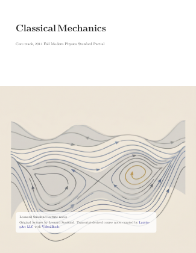</a><br>
      <strong>Klassische Mechanik</strong><br>
      <sub>Stanford-Teillauf</sub>
    </td>
    <td align="center">
      <a href="https://learn.lazying.art/leonardsusskind-reader.html?book=quantum-mechanics-theoretical-minimum"></a><br>
      <strong>Quantenmechanik</strong><br>
      <sub>Winter 2012 Theoretical Minimum</sub>
      <!-- edition-links --><br><sub><a href="https://learn.lazying.art/leonardsusskind-reader.html?book=quantum-mechanics-theoretical-minimum&amp;lang=en">English</a> · <a href="https://learn.lazying.art/leonardsusskind-reader.html?book=quantum-mechanics-theoretical-minimum&amp;lang=ja">日本語</a> · <a href="https://learn.lazying.art/leonardsusskind-reader.html?book=quantum-mechanics-theoretical-minimum&amp;lang=zh">中文</a></sub><!-- /edition-links -->
    </td>
    <td align="center">
      <a href="https://learn.lazying.art/leonardsusskind-reader.html?book=quantum-mechanics-modern-physics-stanford"></a><br>
      <strong>Quantenmechanik</strong><br>
      <sub>Winter 2012 Modern Physics Stanford</sub>
    </td>
  </tr>
  <tr>
    <td align="center">
      <a href="https://learn.lazying.art/leonardsusskind-reader.html?book=special-relativity-theoretical-minimum">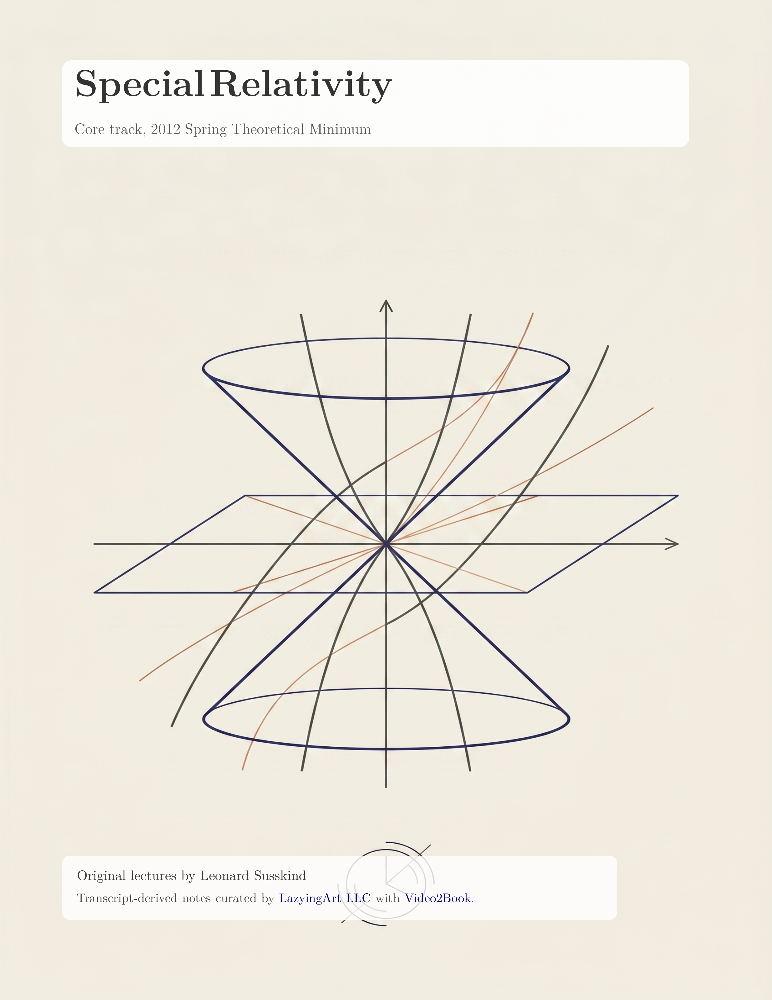</a><br>
      <strong>Spezielle Relativitätstheorie</strong><br>
      <sub>Frühjahr 2012 Theoretical Minimum</sub>
      <!-- edition-links --><br><sub><a href="https://learn.lazying.art/leonardsusskind-reader.html?book=special-relativity-theoretical-minimum&amp;lang=en">English</a> · <a href="https://learn.lazying.art/leonardsusskind-reader.html?book=special-relativity-theoretical-minimum&amp;lang=ja">日本語</a> · <a href="https://learn.lazying.art/leonardsusskind-reader.html?book=special-relativity-theoretical-minimum&amp;lang=zh">中文</a></sub><!-- /edition-links -->
    </td>
    <td align="center">
      <a href="https://learn.lazying.art/leonardsusskind-reader.html?book=general-relativity-theoretical-minimum">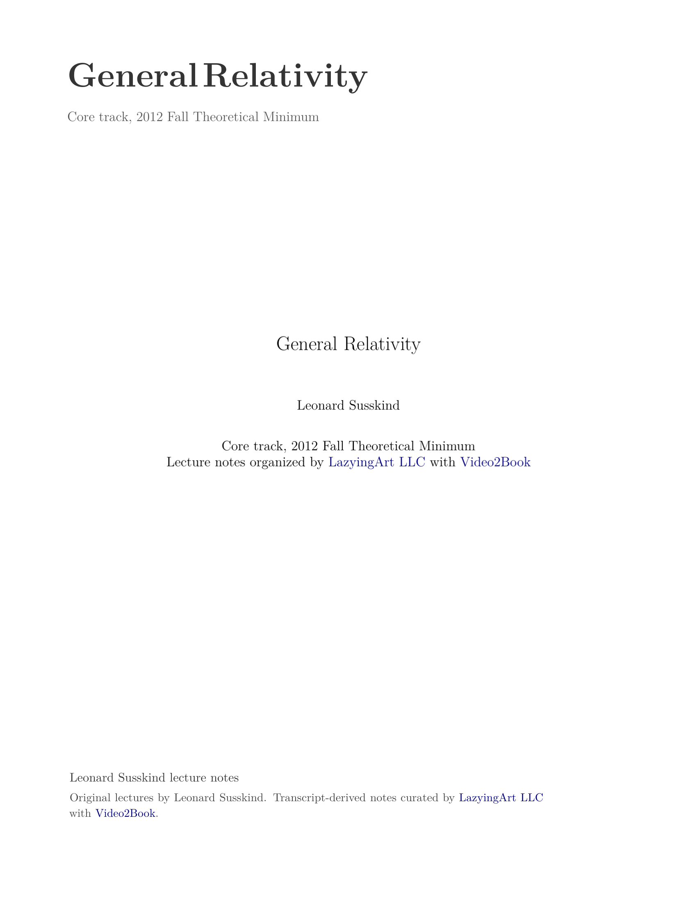</a><br>
      <strong>Allgemeine Relativitätstheorie</strong><br>
      <sub>Herbst 2012 Theoretical Minimum</sub>
      <!-- edition-links --><br><sub><a href="https://learn.lazying.art/leonardsusskind-reader.html?book=general-relativity-theoretical-minimum&amp;lang=en">English</a> · <a href="https://learn.lazying.art/leonardsusskind-reader.html?book=general-relativity-theoretical-minimum&amp;lang=ja">日本語</a> · <a href="https://learn.lazying.art/leonardsusskind-reader.html?book=general-relativity-theoretical-minimum&amp;lang=zh">中文</a></sub><!-- /edition-links -->
    </td>
    <td align="center">
      <a href="https://learn.lazying.art/leonardsusskind-reader.html?book=general-relativity-einstein-2008">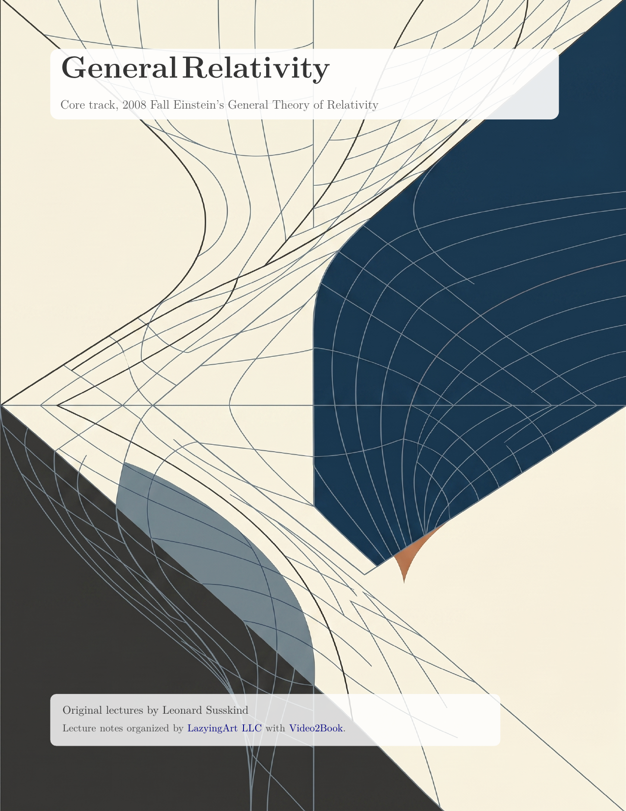</a><br>
      <strong>Allgemeine Relativitätstheorie</strong><br>
      <sub>Herbst 2008 Einsteins Allgemeine Theorie</sub>
    </td>
    <td align="center">
      <a href="https://learn.lazying.art/leonardsusskind-reader.html?book=statistical-mechanics-theoretical-minimum">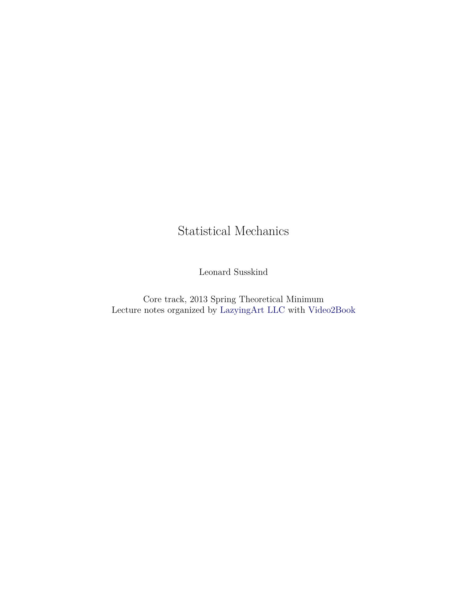</a><br>
      <strong>Statistische Mechanik</strong><br>
      <sub>Frühjahr 2013 Theoretical Minimum</sub>
      <!-- edition-links --><br><sub><a href="https://learn.lazying.art/leonardsusskind-reader.html?book=statistical-mechanics-theoretical-minimum&amp;lang=en">English</a> · <a href="https://learn.lazying.art/leonardsusskind-reader.html?book=statistical-mechanics-theoretical-minimum&amp;lang=ja">日本語</a> · <a href="https://learn.lazying.art/leonardsusskind-reader.html?book=statistical-mechanics-theoretical-minimum&amp;lang=zh">中文</a></sub><!-- /edition-links -->
    </td>
  </tr>
  <tr>
    <td align="center">
      <a href="https://learn.lazying.art/leonardsusskind-reader.html?book=cosmology-theoretical-minimum"></a><br>
      <strong>Kosmologie</strong><br>
      <sub>Winter 2013 Theoretical Minimum</sub>
      <!-- edition-links --><br><sub><a href="https://learn.lazying.art/leonardsusskind-reader.html?book=cosmology-theoretical-minimum&amp;lang=en">English</a> · <a href="https://learn.lazying.art/leonardsusskind-reader.html?book=cosmology-theoretical-minimum&amp;lang=ja">日本語</a> · <a href="https://learn.lazying.art/leonardsusskind-reader.html?book=cosmology-theoretical-minimum&amp;lang=zh">中文</a></sub><!-- /edition-links -->
    </td>
    <td align="center">
      <a href="https://learn.lazying.art/leonardsusskind-reader.html?book=cosmology-legacy">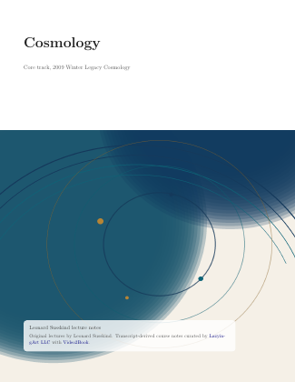</a><br>
      <strong>Kosmologie</strong><br>
      <sub>Legacy-Lauf Winter 2009</sub>
      <!-- edition-links --><br><sub><a href="https://learn.lazying.art/leonardsusskind-reader.html?book=cosmology-legacy&amp;lang=en">English</a> · <a href="https://learn.lazying.art/leonardsusskind-reader.html?book=cosmology-legacy&amp;lang=ja">日本語</a> · <a href="https://learn.lazying.art/leonardsusskind-reader.html?book=cosmology-legacy&amp;lang=zh">中文</a></sub><!-- /edition-links -->
    </td>
    <td></td>
    <td></td>
  </tr>
  <tr>
    <td colspan="4"><strong>Ergänzend</strong> · Quanten → Speziell → Allgemein → Statistisch → Kosmologie</td>
  </tr>
  <tr>
    <td align="center">
      <a href="https://learn.lazying.art/leonardsusskind-reader.html?book=advanced-quantum-mechanics">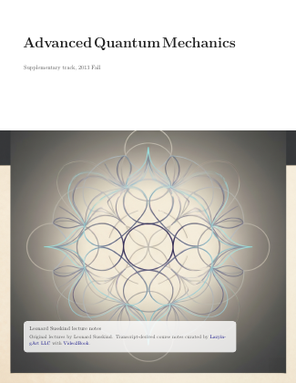</a><br>
      <strong>Fortgeschrittene Quantenmechanik</strong><br>
      <sub>Ergänzendes Kursbuch</sub>
      <!-- edition-links --><br><sub><a href="https://learn.lazying.art/leonardsusskind-reader.html?book=advanced-quantum-mechanics&amp;lang=en">English</a> · <a href="https://learn.lazying.art/leonardsusskind-reader.html?book=advanced-quantum-mechanics&amp;lang=ja">日本語</a> · <a href="https://learn.lazying.art/leonardsusskind-reader.html?book=advanced-quantum-mechanics&amp;lang=zh">中文</a></sub><!-- /edition-links -->
    </td>
    <td align="center">
      <a href="https://learn.lazying.art/leonardsusskind-reader.html?book=quantum-entanglement-part-1">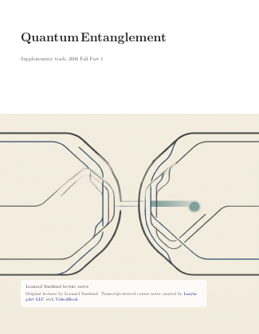</a><br>
      <strong>Quantenverschränkung</strong><br>
      <sub>Teil 1</sub>
      <!-- edition-links --><br><sub><a href="https://learn.lazying.art/leonardsusskind-reader.html?book=quantum-entanglement-part-1&amp;lang=en">English</a> · <a href="https://learn.lazying.art/leonardsusskind-reader.html?book=quantum-entanglement-part-1&amp;lang=ja">日本語</a> · <a href="https://learn.lazying.art/leonardsusskind-reader.html?book=quantum-entanglement-part-1&amp;lang=zh">中文</a></sub><!-- /edition-links -->
    </td>
    <td align="center">
      <a href="https://learn.lazying.art/leonardsusskind-reader.html?book=quantum-entanglement-part-3">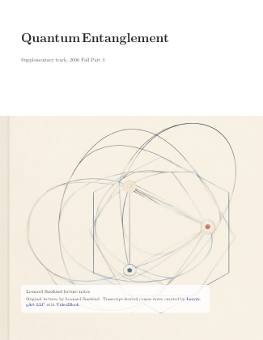</a><br>
      <strong>Quantenverschränkung</strong><br>
      <sub>Teil 3</sub>
      <!-- edition-links --><br><sub><a href="https://learn.lazying.art/leonardsusskind-reader.html?book=quantum-entanglement-part-3&amp;lang=en">English</a> · <a href="https://learn.lazying.art/leonardsusskind-reader.html?book=quantum-entanglement-part-3&amp;lang=ja">日本語</a> · <a href="https://learn.lazying.art/leonardsusskind-reader.html?book=quantum-entanglement-part-3&amp;lang=zh">中文</a></sub><!-- /edition-links -->
    </td>
  </tr>
  <tr>
    <td align="center">
      <a href="https://learn.lazying.art/leonardsusskind-reader.html?book=particle-physics-1-basic-concepts">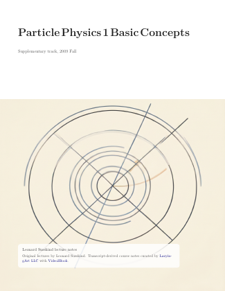</a><br>
      <strong>Teilchenphysik 1</strong><br>
      <sub>Grundbegriffe</sub>
      <!-- edition-links --><br><sub><a href="https://learn.lazying.art/leonardsusskind-reader.html?book=particle-physics-1-basic-concepts&amp;lang=en">English</a> · <a href="https://learn.lazying.art/leonardsusskind-reader.html?book=particle-physics-1-basic-concepts&amp;lang=ja">日本語</a> · <a href="https://learn.lazying.art/leonardsusskind-reader.html?book=particle-physics-1-basic-concepts&amp;lang=zh">中文</a></sub><!-- /edition-links -->
    </td>
    <td align="center">
      <a href="https://learn.lazying.art/leonardsusskind-reader.html?book=particle-physics-2-standard-model">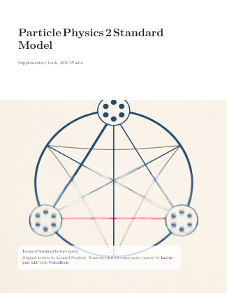</a><br>
      <strong>Teilchenphysik 2</strong><br>
      <sub>Standardmodell</sub>
      <!-- edition-links --><br><sub><a href="https://learn.lazying.art/leonardsusskind-reader.html?book=particle-physics-2-standard-model&amp;lang=en">English</a> · <a href="https://learn.lazying.art/leonardsusskind-reader.html?book=particle-physics-2-standard-model&amp;lang=ja">日本語</a> · <a href="https://learn.lazying.art/leonardsusskind-reader.html?book=particle-physics-2-standard-model&amp;lang=zh">中文</a></sub><!-- /edition-links -->
    </td>
    <td align="center">
      <a href="https://learn.lazying.art/leonardsusskind-reader.html?book=particle-physics-3-supersymmetry-and-grand-unification">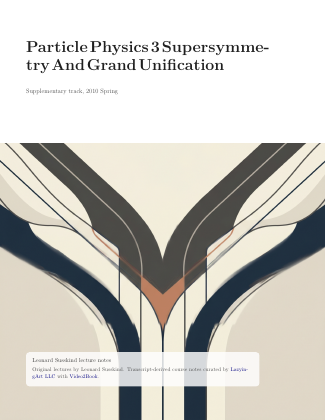</a><br>
      <strong>Teilchenphysik 3</strong><br>
      <sub>Supersymmetrie und Große Vereinheitlichung</sub>
      <!-- edition-links --><br><sub><a href="https://learn.lazying.art/leonardsusskind-reader.html?book=particle-physics-3-supersymmetry-and-grand-unification&amp;lang=en">English</a> · <a href="https://learn.lazying.art/leonardsusskind-reader.html?book=particle-physics-3-supersymmetry-and-grand-unification&amp;lang=ja">日本語</a> · <a href="https://learn.lazying.art/leonardsusskind-reader.html?book=particle-physics-3-supersymmetry-and-grand-unification&amp;lang=zh">中文</a></sub><!-- /edition-links -->
    </td>
  </tr>
  <tr>
    <td align="center">
      <a href="https://learn.lazying.art/leonardsusskind-reader.html?book=topics-in-string-theory">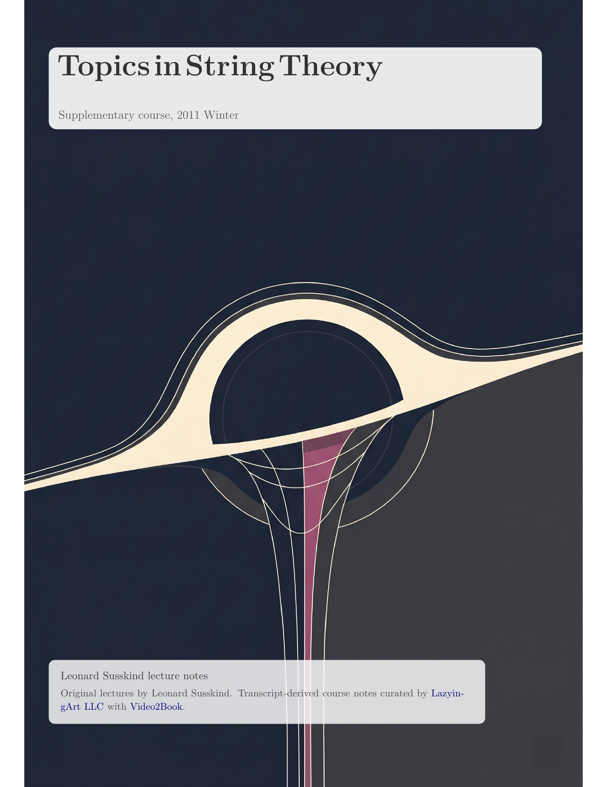</a><br>
      <strong>Themen der Stringtheorie</strong><br>
      <sub>Kosmologie- und Schwarze-Löcher-Sammlung</sub>
      <!-- edition-links --><br><sub><a href="https://learn.lazying.art/leonardsusskind-reader.html?book=topics-in-string-theory&amp;lang=en">English</a> · <a href="https://learn.lazying.art/leonardsusskind-reader.html?book=topics-in-string-theory&amp;lang=ja">日本語</a> · <a href="https://learn.lazying.art/leonardsusskind-reader.html?book=topics-in-string-theory&amp;lang=zh">中文</a></sub><!-- /edition-links -->
    </td>
    <td align="center">
      <a href="https://learn.lazying.art/leonardsusskind-reader.html?book=string-theory-and-m-theory">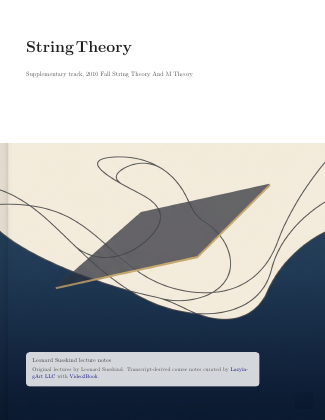</a><br>
      <strong>String Theory and M-Theory</strong><br>
      <sub>Ergänzendes Kursbuch</sub>
      <!-- edition-links --><br><sub><a href="https://learn.lazying.art/leonardsusskind-reader.html?book=string-theory-and-m-theory&amp;lang=en">English</a> · <a href="https://learn.lazying.art/leonardsusskind-reader.html?book=string-theory-and-m-theory&amp;lang=ja">日本語</a> · <a href="https://learn.lazying.art/leonardsusskind-reader.html?book=string-theory-and-m-theory&amp;lang=zh">中文</a></sub><!-- /edition-links -->
    </td>
    <td align="center">
      <a href="https://learn.lazying.art/leonardsusskind-reader.html?book=demystifying-the-higgs-boson">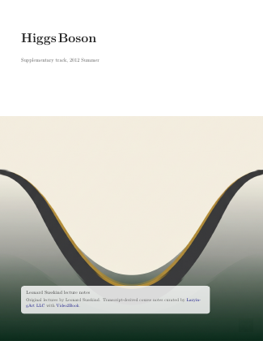</a><br>
      <strong>Entmystifizierung des Higgs-Bosons</strong><br>
      <sub>Buch zu einer einzelnen Vorlesung</sub>
      <!-- edition-links --><br><sub><a href="https://learn.lazying.art/leonardsusskind-reader.html?book=demystifying-the-higgs-boson&amp;lang=en">English</a> · <a href="https://learn.lazying.art/leonardsusskind-reader.html?book=demystifying-the-higgs-boson&amp;lang=ja">日本語</a> · <a href="https://learn.lazying.art/leonardsusskind-reader.html?book=demystifying-the-higgs-boson&amp;lang=zh">中文</a></sub><!-- /edition-links -->
    </td>
  </tr>
</table>

## ✨ Was dieses Repository bereitstellt

- Bereits vorhandene, manuell gepflegte Kurs-PDFs und LaTeX-Materialien in den Ordnern `core_*` und `supplemental_*`.
- Eine zweigeteilte Transkriptionsschicht für das Vorlesungsarchiv:
  - `subtitles/` für `.srt`
  - `markdown/` für mit Zeitstempeln versehene Markdown-Transkripte
- Eine Transkript-zu-TeX-Pipeline in `generated_course_notes/`.
- Das Submodul `Video2Book/` für Playlist-Download, Transkription und Untertitel-zu-Notizen-Automatisierung.
- Importiertes Begleitmaterial in `theoretical_minimum_companion_notes/`.
- Wiederverwendbare LaTeX-Templates in `template/kaobook` und `template/tuftle`.

Englisch ist die kanonische README. Übersetzungen liegen in `i18n/` und können gegenüber der englischen Datei hinterherhinken.

## 🎬 Quell-Playlist

Das Hauptarchiv der Transkripte und Untertitel in diesem Repository stammt aus dieser YouTube-Playlist:

- <https://www.youtube.com/playlist?list=PLERGeJGfknBTR_nXt5QL88xJF5LhDZBnG>

## 🗂️ Repository-Layout

<table>
  <colgroup>
    <col style="width: 33%">
    <col style="width: 33%">
    <col style="width: 34%">
  </colgroup>
  <thead>
    <tr>
      <th>📚 Ebene</th>
      <th>📍 Hauptpfad</th>
      <th>🧾 Inhalt</th>
    </tr>
  </thead>
  <tbody>
    <tr>
      <td>Manuell gepflegte Kursordner</td>
      <td><code>core_*</code>, <code>supplemental_*</code></td>
      <td>Leserorientierte Kursordner, veröffentlichte PDFs, READMEs und ausgewählte LaTeX-Quellen.</td>
    </tr>
    <tr>
      <td>Untertitel</td>
      <td><code>subtitles/</code></td>
      <td>Untertiteldateien der Vorlesungen im Format <code>.srt</code>.</td>
    </tr>
    <tr>
      <td>Markdown-Transkripte</td>
      <td><code>markdown/</code></td>
      <td>Mit Zeitstempeln versehene Vorlesungstranskripte für Lesen, Suche und Notizgenerierung.</td>
    </tr>
    <tr>
      <td>Quellen der generierten Notizen</td>
      <td><code>generated_course_notes/</code></td>
      <td>Aus Transkripten abgeleitete TeX-Kapitel, Abbildungen, Prompts und Build-Material für Kurse.</td>
    </tr>
    <tr>
      <td>Veröffentlichte generierte PDFs</td>
      <td><code>supplemental_*/</code></td>
      <td>Kanonische veröffentlichte Ausgaben für fertig generierte Kurse, mit einem kursspezifischen zusammengeführten PDF-Dateinamen plus <code>lecture_XX.pdf</code>-Dateien.</td>
    </tr>
    <tr>
      <td>Legacy-Build-Artefakte</td>
      <td><code>core_cosmology/cosmology_ch10/artifacts/</code></td>
      <td>Build-Ausgaben, die für das ältere Kapitel-10-Kosmologie-Teilprojekt aufbewahrt werden.</td>
    </tr>
    <tr>
      <td>Begleitnotizen</td>
      <td><code>theoretical_minimum_companion_notes/</code></td>
      <td>Importierte TeX-Begleitnotizen, abgeleitet aus dem Projekt <code>weka511/tm</code>.</td>
    </tr>
    <tr>
      <td>Templates und gemeinsames Material</td>
      <td><code>template/</code>, <code>figs/</code>, <code>the_theoretical_minimum/</code>, <code>Video2Book/</code></td>
      <td>LaTeX-Templates, gemeinsames Branding/Assets, der zugehörige Submodul-Checkout und das Submodul für Download-/Transkriptionsautomatisierung.</td>
    </tr>
  </tbody>
</table>

Innerhalb von `subtitles/`, `markdown/` und `generated_course_notes/` ist das Material nach Spur (`core/` oder `supplementary`), dann nach Fach und dann nach Kurslauf organisiert.

Bei generierten Notizen enthält jeder Kursordner üblicherweise:

- `chapters/` für Vorlesung-für-Vorlesung-TeX und PDF-Dateien pro Vorlesung
- `figures/` für extrahierte Vorlesungsframes und Abbildungs-Assets
- `course.tex` und `course.pdf` für das zusammengeführte vollständige Kursbuch

## 🧭 Kursordner auf Root-Ebene

| 🏷️ Gruppe | 📂 Ordner |
|---|---|
| Kern | `core_classical_mechanics`, `core_quantum_mechanics`, `core_special_relativity`, `core_general_relativity`, `core_cosmology`, `core_statistical_mechanics` |
| Ergänzend | `supplemental_advanced_quantum`, `supplemental_cosmology_and_black_holes`, `supplemental_higgs_boson`, `supplemental_particle_physics_1`, `supplemental_particle_physics_2`, `supplemental_particle_physics_3`, `supplemental_quantum_entanglement`, `supplemental_relativity`, `supplemental_string_theory` |

## 🚀 So nutzt man das Repository

### 📖 Veröffentlichte Notizen lesen

Öffnen Sie die PDFs im entsprechenden Kursordner, zum Beispiel:

- `../core_classical_mechanics/2011_fall_theoretical_minimum/classical_mechanics_theoretical_minimum.pdf`
- `../core_classical_mechanics/2011_fall_modern_physics_stanford_partial/classical_mechanics_stanford_partial.pdf`
- `../core_quantum_mechanics/2012_winter_theoretical_minimum/quantum_mechanics_theoretical_minimum.pdf`
- `../core_quantum_mechanics/2012_winter_modern_physics_stanford/quantum_mechanics_modern_physics_stanford.pdf`
- `../core_special_relativity/2012_spring_theoretical_minimum/special_relativity_theoretical_minimum.pdf`
- `../core_general_relativity/2012_fall_theoretical_minimum/general_relativity_theoretical_minimum.pdf`
- `../core_cosmology/2013_winter_theoretical_minimum/cosmology_theoretical_minimum.pdf`
- `../core_cosmology/2009_winter_legacy_cosmology/cosmology_legacy.pdf`
- `../core_statistical_mechanics/lesson_1.pdf`
- `../supplemental_advanced_quantum/advanced_quantum_mechanics.pdf`
- `../supplemental_cosmology_and_black_holes/topics_in_string_theory.pdf`
- `../supplemental_higgs_boson/demystifying_the_higgs_boson.pdf`
- `../supplemental_particle_physics_1/particle_physics_1_basic_concepts.pdf`
- `../supplemental_particle_physics_2/particle_physics_2_standard_model.pdf`
- `../supplemental_particle_physics_3/particle_physics_3_supersymmetry_and_grand_unification.pdf`
- `../supplemental_quantum_entanglement/quantum_entanglement_part_1.pdf`
- `../supplemental_quantum_entanglement/quantum_entanglement_part_3.pdf`
- `../supplemental_string_theory/string_theory_and_m_theory.pdf`

### 📝 Transkripte direkt lesen

Verwenden Sie:

- `../subtitles/` für Lesen im Untertitelstil und Zeitstempelgenauigkeit
- `../markdown/` für Textprüfung, Suche und Notizgenerierung

### ⬇️ Die Quell-Playlist aktualisieren

Verwenden Sie den übergeordneten Wrapper, der an das Submodul `Video2Book` delegiert:

```bash
./scripts/download_susskind_playlist.sh
```

### 🎙️ Die Transkriptionswarteschlange starten

Verwenden Sie die übergeordneten Wrapper, die an das Submodul `Video2Book` delegieren:

```bash
./scripts/start_transcription_tmux.sh
./scripts/start_transcription_monitor_tmux.sh
```

### 🧪 An aus Transkripten abgeleiteten Notizen arbeiten

Der Arbeitsbereich für generierte Notizen befindet sich unter:

- `../generated_course_notes/`

Innerhalb jedes Kurslaufs:

- enthält `chapters/` einen Ordner pro Vorlesung
- enthält jeder Vorlesungsordner das Kapitel-TeX und das kompilierte Vorlesungs-PDF
- ist `course.pdf` das zusammengeführte vollständige Kurs-PDF für diesen Lauf

Starten Sie den Notiz-Kurator über die übergeordneten Wrapper, die an das Submodul `Video2Book` delegieren:

```bash
./scripts/start_course_notes_tmux.sh
./scripts/start_course_notes_monitor_tmux.sh
```

### 📘 Kompakte Pocket-Format-PDFs exportieren

Erzeugen Sie handliche 6x9-Zoll-Varianten aus fertigem generiertem Kurs-LaTeX:

```bash
./scripts/export_course_pocket_pdfs.sh
./scripts/export_course_pocket_pdfs.sh --size a5 --suffix a5
```

Die Ausgaben werden standardmäßig nach `../all_notes/pocket_books/<course>_pocket.pdf` geschrieben (kanonische
Dateinamen, mit optionalem benutzerdefiniertem Suffix über `--suffix`).

### 📚 An importierten Begleitnotizen arbeiten

```bash
./theoretical_minimum_companion_notes/build_all.sh
```

## 🤝 Zusammenarbeit

Beiträge, die die mathematische Qualität, Klarheit und Bewahrung von Leonard-Susskind-bezogenem Studienmaterial verbessern, sind willkommen.

Prioritäre Bereiche sind:

- Bereinigung von Transkripten
  - Sprecherzuordnung korrigieren
  - Zeitstempel reparieren
  - physikalische Begriffe, Namen und Notation korrigieren
- TeX-Verbesserung
  - Transkripte in eine sauberere mathematische Darstellung überführen
  - Struktur, Typografie und Querverweise verbessern
  - generierte Kapitel zu belastbaren Kursnotizen ausarbeiten
- Arbeit an Abbildungen und Gleichungen
  - extrahierte Vorlesungsframes verifizieren
  - Diagramme in TikZ neu zeichnen
  - Tafelgleichungen in zuverlässiges LaTeX überführen
- breitere Physik-Archivierungsarbeit
  - Begleitmaterial zu *Theoretical Minimum* verbessern
  - zugehörige Susskind-Vorlesungen, Bücher und Notizensammlungen verknüpfen
  - dabei helfen, diesen Bestand an Physiklehre verantwortungsvoll zu verbreiten und zu bewahren

Beiträge sollten fokussierte Commits verwenden und die exakt geänderten Ordner, Transkripte oder Kursläufe benennen.

## 🙏 Danksagungen

- Leonard Susskind für den ursprünglichen Vorlesungsinhalt.
- Repository-Kuration und Veröffentlichungs-Tooling: [LazyingArt LLC](https://lazying.art)
- Simon Crase für das Begleitnotiz-Repository, das nach `../theoretical_minimum_companion_notes/` importiert wurde.
- Quell-Repository der Begleitnotizen: <https://github.com/weka511/tm>
- Vorhandene referenzierte Notizquellen:
  - <https://www.lapasserelle.com/general_relativity/>
  - <https://www.lapasserelle.com/cosmology/>
  - <https://www.lapasserelle.com/statistical_mechanics/>
- Herkunftsvermerk für die älteren, von La Passerelle abgeleiteten PDF-Sammlungen:
  - [`../references/lapasserelle_susskind_pdf_provenance.md`](../references/lapasserelle_susskind_pdf_provenance.md)

## ❤️ Unterstützung

Hast du eine eigene Vorlesungsaufnahme oder die Erlaubnis, sie zu verwenden? Das separate Pilotangebot [Bilingual Lecture Pack](https://lazying.art/lecture-pack/?utm_source=github&utm_medium=readme&utm_campaign=leonard_susskind_archive&utm_content=rights_cleared_lecture) arbeitet ausschließlich mit kundeneigenem oder rechtlich freigegebenem Material. Dieses Susskind-Archiv bleibt kostenlos und wird nicht über diesen Dienst verkauft.

<!-- support:start -->
[](https://github.com/sponsors/lachlanchen)
[](https://chat.lazying.art/donate)
[](https://paypal.me/RongzhouChen)
[](https://buy.stripe.com/aFadR8gIaflgfQV6T4fw400)
<!-- support:end -->

## Lizenz

Dieses Repository ist unter der GNU General Public License v3.0 lizenziert. Siehe [LICENSE](../LICENSE).

## In Bunko lesen

[Bunko](https://lachlan.lazying.art/Bunko/) · Für 16 abschließend redigierte Bücher sind japanische und vereinfachte chinesische Ausgaben neben den englischen Originalen verfügbar. PDFs sind eigenständige Sprachausgaben; Bunko bietet ausgerichtete Sprachebenen.


<!-- polished-translations:start -->
## Uebersetzungen der finalen Ausgabe

Japanische und chinesische Ausgaben entstehen aus den final redigierten englischen Notizen. Formeln und Abbildungen bleiben erhalten; nur gepruefte PDFs werden verlinkt.

[Verfuegbarkeit und Pruefverfahren](../README.md#final-polished-translations)
<!-- polished-translations:end -->

<!-- reading-citation:start -->
## Zitation und Unterstützung

Diese Angabe zitiert die unabhängigen Begleitnotizen; die Originalvorlesungen bitte gesondert zitieren.

[CITATION.cff](../CITATION.cff) · [GitHub Sponsors](https://github.com/sponsors/lachlanchen)

```bibtex
@software{lazyingart_susskind_companion_notes,
  author = {{LazyingArt contributors}},
  title = {Leonard Susskind Lecture Notes: Independent Multilingual Companion Editions},
  url = {https://github.com/lachlanchen/leonardsusskind}
}
```
<!-- reading-citation:end -->
