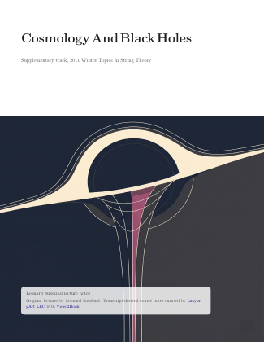
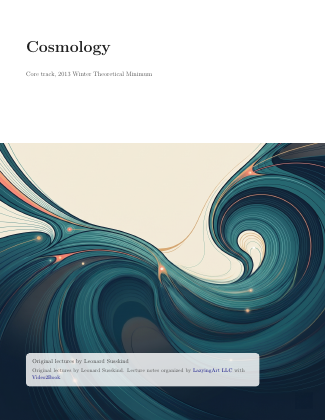

[English](../README.md) · [العربية](README.ar.md) · [Español](README.es.md) · [Français](README.fr.md) · [日本語](README.ja.md) · [한국어](README.ko.md) · [Tiếng Việt](README.vi.md) · [中文 (简体)](README.zh-Hans.md) · [中文（繁體）](README.zh-Hant.md) · [Deutsch](README.de.md) · [Русский](README.ru.md)


[](https://lazying.art)

# Kho Lưu Trữ Ghi Chú Bài Giảng Leonard Susskind

<!-- reading-languages:start -->
## Đọc bằng tiếng Anh, tiếng Nhật và tiếng Trung

Có bản tiếng Nhật và tiếng Trung giản thể cho 16 sách đã hiệu đính, bên cạnh bản gốc tiếng Anh. PDF là sách độc lập theo từng ngôn ngữ; Bunko cho phép chọn các lớp ngôn ngữ tương ứng.

PDF dịch mới dùng giấy 177.6 × 252 mm (mỗi chiều A5 × 1.2), chữ 12 pt, giữ nguyên công thức và hình. “pocket 1.2x” cũ chỉ cỡ chữ phóng lớn, không phải khổ giấy này.

Chúng tôi đang mở rộng thư viện đa ngôn ngữ. Mời đóng góp ngôn ngữ mới, hiệu đính khoa học, khả năng tiếp cận và dàn trang qua issue hoặc bản sửa có nguồn. Các ngôn ngữ khác đang được lên kế hoạch, chưa xuất bản.

[Bunko](https://lachlan.lazying.art/Bunko/) · [LazyLearn](https://learn.lazying.art/leonardsusskind-reader.html) · [GitHub Issues](https://github.com/lachlanchen/leonardsusskind/issues)
<!-- reading-languages:end -->

<!-- language-covers:start -->
<table>
<tr><td></td><td><strong>Demystifying the Higgs Boson</strong><br><a href="https://learn.lazying.art/leonardsusskind-reader.html?book=demystifying-the-higgs-boson&amp;lang=en">English</a> · <a href="https://learn.lazying.art/leonardsusskind-reader.html?book=demystifying-the-higgs-boson&amp;lang=ja">日本語</a> · <a href="https://learn.lazying.art/leonardsusskind-reader.html?book=demystifying-the-higgs-boson&amp;lang=zh">中文</a></td></tr>
<tr><td></td><td><strong>Advanced Quantum Mechanics</strong><br><a href="https://learn.lazying.art/leonardsusskind-reader.html?book=advanced-quantum-mechanics&amp;lang=en">English</a> · <a href="https://learn.lazying.art/leonardsusskind-reader.html?book=advanced-quantum-mechanics&amp;lang=ja">日本語</a> · <a href="https://learn.lazying.art/leonardsusskind-reader.html?book=advanced-quantum-mechanics&amp;lang=zh">中文</a></td></tr>
<tr><td></td><td><strong>Quantum Entanglement Part 1</strong><br><a href="https://learn.lazying.art/leonardsusskind-reader.html?book=quantum-entanglement-part-1&amp;lang=en">English</a> · <a href="https://learn.lazying.art/leonardsusskind-reader.html?book=quantum-entanglement-part-1&amp;lang=ja">日本語</a> · <a href="https://learn.lazying.art/leonardsusskind-reader.html?book=quantum-entanglement-part-1&amp;lang=zh">中文</a></td></tr>
<tr><td></td><td><strong>Quantum Entanglement Part 3</strong><br><a href="https://learn.lazying.art/leonardsusskind-reader.html?book=quantum-entanglement-part-3&amp;lang=en">English</a> · <a href="https://learn.lazying.art/leonardsusskind-reader.html?book=quantum-entanglement-part-3&amp;lang=ja">日本語</a> · <a href="https://learn.lazying.art/leonardsusskind-reader.html?book=quantum-entanglement-part-3&amp;lang=zh">中文</a></td></tr>
<tr><td></td><td><strong>Particle Physics 1: Basic Concepts</strong><br><a href="https://learn.lazying.art/leonardsusskind-reader.html?book=particle-physics-1-basic-concepts&amp;lang=en">English</a> · <a href="https://learn.lazying.art/leonardsusskind-reader.html?book=particle-physics-1-basic-concepts&amp;lang=ja">日本語</a> · <a href="https://learn.lazying.art/leonardsusskind-reader.html?book=particle-physics-1-basic-concepts&amp;lang=zh">中文</a></td></tr>
<tr><td></td><td><strong>Particle Physics 2: Standard Model</strong><br><a href="https://learn.lazying.art/leonardsusskind-reader.html?book=particle-physics-2-standard-model&amp;lang=en">English</a> · <a href="https://learn.lazying.art/leonardsusskind-reader.html?book=particle-physics-2-standard-model&amp;lang=ja">日本語</a> · <a href="https://learn.lazying.art/leonardsusskind-reader.html?book=particle-physics-2-standard-model&amp;lang=zh">中文</a></td></tr>
<tr><td></td><td><strong>Particle Physics 3: Supersymmetry and Grand Unification</strong><br><a href="https://learn.lazying.art/leonardsusskind-reader.html?book=particle-physics-3-supersymmetry-and-grand-unification&amp;lang=en">English</a> · <a href="https://learn.lazying.art/leonardsusskind-reader.html?book=particle-physics-3-supersymmetry-and-grand-unification&amp;lang=ja">日本語</a> · <a href="https://learn.lazying.art/leonardsusskind-reader.html?book=particle-physics-3-supersymmetry-and-grand-unification&amp;lang=zh">中文</a></td></tr>
<tr><td></td><td><strong>Topics in String Theory</strong><br><a href="https://learn.lazying.art/leonardsusskind-reader.html?book=topics-in-string-theory&amp;lang=en">English</a> · <a href="https://learn.lazying.art/leonardsusskind-reader.html?book=topics-in-string-theory&amp;lang=ja">日本語</a> · <a href="https://learn.lazying.art/leonardsusskind-reader.html?book=topics-in-string-theory&amp;lang=zh">中文</a></td></tr>
<tr><td></td><td><strong>String Theory and M-Theory</strong><br><a href="https://learn.lazying.art/leonardsusskind-reader.html?book=string-theory-and-m-theory&amp;lang=en">English</a> · <a href="https://learn.lazying.art/leonardsusskind-reader.html?book=string-theory-and-m-theory&amp;lang=ja">日本語</a> · <a href="https://learn.lazying.art/leonardsusskind-reader.html?book=string-theory-and-m-theory&amp;lang=zh">中文</a></td></tr>
<tr><td></td><td><strong>Classical Mechanics</strong><br><a href="https://learn.lazying.art/leonardsusskind-reader.html?book=classical-mechanics-theoretical-minimum&amp;lang=en">English</a> · <a href="https://learn.lazying.art/leonardsusskind-reader.html?book=classical-mechanics-theoretical-minimum&amp;lang=ja">日本語</a> · <a href="https://learn.lazying.art/leonardsusskind-reader.html?book=classical-mechanics-theoretical-minimum&amp;lang=zh">中文</a></td></tr>
<tr><td></td><td><strong>Quantum Mechanics</strong><br><a href="https://learn.lazying.art/leonardsusskind-reader.html?book=quantum-mechanics-theoretical-minimum&amp;lang=en">English</a> · <a href="https://learn.lazying.art/leonardsusskind-reader.html?book=quantum-mechanics-theoretical-minimum&amp;lang=ja">日本語</a> · <a href="https://learn.lazying.art/leonardsusskind-reader.html?book=quantum-mechanics-theoretical-minimum&amp;lang=zh">中文</a></td></tr>
<tr><td></td><td><strong>Special Relativity</strong><br><a href="https://learn.lazying.art/leonardsusskind-reader.html?book=special-relativity-theoretical-minimum&amp;lang=en">English</a> · <a href="https://learn.lazying.art/leonardsusskind-reader.html?book=special-relativity-theoretical-minimum&amp;lang=ja">日本語</a> · <a href="https://learn.lazying.art/leonardsusskind-reader.html?book=special-relativity-theoretical-minimum&amp;lang=zh">中文</a></td></tr>
<tr><td></td><td><strong>General Relativity</strong><br><a href="https://learn.lazying.art/leonardsusskind-reader.html?book=general-relativity-theoretical-minimum&amp;lang=en">English</a> · <a href="https://learn.lazying.art/leonardsusskind-reader.html?book=general-relativity-theoretical-minimum&amp;lang=ja">日本語</a> · <a href="https://learn.lazying.art/leonardsusskind-reader.html?book=general-relativity-theoretical-minimum&amp;lang=zh">中文</a></td></tr>
<tr><td></td><td><strong>Statistical Mechanics</strong><br><a href="https://learn.lazying.art/leonardsusskind-reader.html?book=statistical-mechanics-theoretical-minimum&amp;lang=en">English</a> · <a href="https://learn.lazying.art/leonardsusskind-reader.html?book=statistical-mechanics-theoretical-minimum&amp;lang=ja">日本語</a> · <a href="https://learn.lazying.art/leonardsusskind-reader.html?book=statistical-mechanics-theoretical-minimum&amp;lang=zh">中文</a></td></tr>
<tr><td></td><td><strong>Cosmology</strong><br><a href="https://learn.lazying.art/leonardsusskind-reader.html?book=cosmology-theoretical-minimum&amp;lang=en">English</a> · <a href="https://learn.lazying.art/leonardsusskind-reader.html?book=cosmology-theoretical-minimum&amp;lang=ja">日本語</a> · <a href="https://learn.lazying.art/leonardsusskind-reader.html?book=cosmology-theoretical-minimum&amp;lang=zh">中文</a></td></tr>
<tr><td></td><td><strong>Cosmology</strong><br><a href="https://learn.lazying.art/leonardsusskind-reader.html?book=cosmology-legacy&amp;lang=en">English</a> · <a href="https://learn.lazying.art/leonardsusskind-reader.html?book=cosmology-legacy&amp;lang=ja">日本語</a> · <a href="https://learn.lazying.art/leonardsusskind-reader.html?book=cosmology-legacy&amp;lang=zh">中文</a></td></tr>
</table>
<!-- language-covers:end -->


> 🎓 Kho tài liệu đa ngôn ngữ cho các ghi chú bài giảng của Leonard Susskind, bảo toàn cả bản PDF đã hoàn thiện và nguồn LaTeX có thể chỉnh sửa để học tập, tái sử dụng và tra cứu.

---

## Tổng quan
Kho lưu trữ này là kho tài liệu trọng tâm cho các ghi chú giảng dạy của Giáo sư Leonard Susskind.

> Đây là các ghi chú bài giảng của Giáo sư Leonard Susskind. Nếu điều này vi phạm bản quyền, vui lòng liên hệ để tôi xóa kho này. Giáo sư Susskind không chịu trách nhiệm cho lỗi hay thông tin sai trong các ghi chú, tôi cũng vậy.

> **Lưu ý về ấn bản:** bản chép lời có dấu thời gian được tạo tự động và có thể chứa lỗi nhận dạng. Các sách PDF là ghi chú đồng hành được biên tập độc lập với sự hỗ trợ của AI, tái dựng từ bản chép lời và hình ảnh bảng; chúng không phải bản chép nguyên văn, bản thảo gốc hay ấn bản được Leonard Susskind phê duyệt. Đợt [biên tập lại](../references/editorial_revision_status.md) đang ghi nguồn và xuất xứ hình ảnh cho từng chương.

Nó kết hợp ba lớp tại cùng một nơi:

- Theo dõi chuyên mục ghi chú và tiến độ theo khóa học.
- Tài liệu đã xuất bản (`.pdf`) để đọc và chia sẻ.
- Tệp nguồn (`.tex`, `.bib`, template) cho những ai duy trì hoặc mở rộng kho.

### Mục tiêu chính
- Tập hợp ghi chú khóa học và tiến trình tại một điểm duy nhất.
- Duy trì khả năng theo dõi tiến độ bản thảo/ghi chú cho cả nhánh cốt lõi và bổ sung.
- Cung cấp tài liệu nguồn (PDF, TeX, BibTeX, template) để tiếp tục soạn thảo.

## Tính năng
- 📚 Theo dõi khóa học cốt lõi và tài liệu tham chiếu.
- 📌 Theo dõi tiến độ khóa học bổ sung.
- 📄 Các PDF bài học đã có cho nhiều nhánh cốt lõi.
- 🧪 Nguồn LaTeX ở một số nhánh được chọn.
- 🧷 Các template LaTeX tái sử dụng trong `template/tuftle` và `template/kaobook`.
- 🎨 Hình ảnh nhận diện trong `figs/`.
- 🌐 Bộ README đa ngôn ngữ trong `i18n/`.

## Bức tranh nhanh
| Khu vực | Nội dung có sẵn |
|---|---|
| 📝 Ghi chú | Nhiều bộ ghi chú theo khóa học kèm theo theo dõi tiến độ |
| 🧾 Nguồn | Nguồn TeX/BibTeX trong các dự án con đã chọn |
| 🧱 Template | `template/tuftle` và `template/kaobook` |
| 🎨 Nhận diện | `figs/banner.*`, `figs/logo.*`, `figs/logo-w-text.*` |
| 🌍 i18n | Các biến thể `i18n/README.*.md` |

## Mục lục
- [Tổng quan](#tổng-quan)
- [Tính năng](#tính-năng)
- [Bức tranh nhanh](#bức-tranh-nhanh)
- [Cấu trúc dự án](#cấu-trúc-dự-án)
- [Yêu cầu tiền đề](#yêu-cầu-tiền-đề)
- [Cài đặt](#cài-đặt)
- [Sử dụng](#sử-dụng)
- [Cấu hình](#cấu-hình)
- [Ví dụ](#ví-dụ)
- [Ghi chú phát triển](#ghi-chú-phát-triển)
- [Tiến độ khóa học chuẩn (được bảo toàn và tái tổ chức)](#tiến-độ-khóa-học-chuẩn-được-bảo-quản-và-tái-tổ-chức)
- [Khắc phục sự cố](#khắc-phục-sự-cố)
- [Lộ trình](#lộ-trình)
- [Đóng góp](#đóng-góp)
- [❤️ Support](#-support)
- [Lời cảm ơn](#lời-cảm-ơn)
- [Giấy phép](#giấy-phép)

## Cấu trúc dự án
```text
leonardsusskind/
├── README.md
├── LICENSE
├── tuftle_book_guide.pdf
├── figs/
│   ├── banner.(png|svg)
│   ├── logo.(png|svg)
│   └── logo-w-text.(png|svg)
├── i18n/
│   ├── README.ar.md
│   ├── README.de.md
│   ├── README.es.md
│   ├── README.fr.md
│   ├── README.ja.md
│   ├── README.ko.md
│   ├── README.ru.md
│   ├── README.vi.md
│   ├── README.zh-Hans.md
│   └── README.zh-Hant.md
├── core_classical_mechanics/
│   └── README.md
├── core_quantum_mechanics/
│   └── README.md
├── core_special_relativity/
│   └── README.md
├── core_general_relativity/
│   ├── README.md
│   └── lesson_1.pdf ... lesson_10.pdf
├── core_cosmology/
│   ├── README.md
│   ├── lesson_1.pdf ... lesson_9.pdf
│   └── cosmology_ch10/
│       ├── cosmology_ch10.tex
│       └── ref.bib
├── core_statistical_mechanics/
│   ├── README.md
│   └── lesson_1.pdf ... lesson_11.pdf
├── supplemental_advanced_quantum/
│   ├── README.md
│   └── ch1/
│       ├── main.tex
│       ├── book_1_template.tex
│       └── bibliography.bib
├── supplemental_cosmology_and_black_holes/
│   └── README.md
├── supplemental_higgs_boson/
│   └── README.md
├── supplemental_particle_physics_1/
│   ├── README.md
│   ├── ch1/
│   │   ├── main.tex
│   │   ├── book_1_template.tex
│   │   └── bibliography.bib
│   └── lecture transcript .txt files
├── supplemental_particle_physics_2/
│   ├── README.md
│   ├── NumberTheory.pdf
│   └── lecture transcript .txt files
├── supplemental_particle_physics_3/
│   └── README.md
├── supplemental_quantum_entanglement/
│   └── README.md
├── supplemental_relativity/
│   └── README.md
├── supplemental_string_theory/
│   └── README.md
└── template/
    ├── kaobook/
    │   ├── main.tex
    │   ├── structure.tex
    │   └── bibliography.bib
    └── tuftle/
        ├── main.tex
        ├── book_1_template.tex
        └── bibliography.bib
```

## Yêu cầu tiền đề
Để đọc:
- 📖 Trình đọc PDF (trên máy hoặc ứng dụng).

Để chỉnh sửa/xây dựng tài liệu TeX:
- 📦 Bộ phân phối LaTeX (`TeX Live` / `MiKTeX`).
- ⚙️ `pdflatex`.
- 🗂️ `bibtex` hoặc `biber` tùy dự án con.
- 🔎 `makeindex` cho các dự án có mục lục chỉ mục.

---

### Ghi chú giả định:
- Không có hệ thống build gốc duy nhất (`Makefile`, `package.json`, `pyproject.toml`) hiển thị ở cấp repository này.
- Các workflow build dự kiến chạy từ từng thư mục con.

## Cài đặt
```bash
# Clone the repository
git clone https://github.com/lachlanchen/leonardsusskind.git
cd leonardsusskind
```

Kho này theo hướng tiếp cận nội dung trước tiên. Nếu bị sao chép hoặc fork, hãy thay `remote` bằng bản sao của bạn.

Không cần cài đặt package toàn cục để đọc các ghi chú hiện có.

## Sử dụng
### 1) Đọc ghi chú hiện có
Mở PDF trong các thư mục tương ứng, ví dụ:
- `core_general_relativity/lesson_1.pdf`
- `core_cosmology/lesson_1.pdf`
- `core_statistical_mechanics/lesson_1.pdf`
- `supplemental_particle_physics_2/NumberTheory.pdf`

### 2) Tạo mới hoặc mở rộng tài liệu LaTeX
- Chỉnh sửa tệp `.tex` và `.bib` trong thư mục khóa học/template mục tiêu.
- Biên dịch theo workflow đã quy định của từng thư mục.
- Build tại chỗ để tài nguyên tương đối và style resolve đúng.

### 3) Di chuyển theo điểm vào theo từng nhánh
Mỗi nhánh chính có `README.md` riêng với ghi chú phạm vi, tham khảo và tiến độ.

## Cấu hình
Không có tệp cấu hình toàn cục.

Cấu hình nằm cục bộ trong từng dự án TeX. Các điều chỉnh phổ biến thường nằm trong nguồn tài liệu, gồm:
- Lớp tài liệu và thiết lập package trong `template/kaobook/main.tex`
- Style/structure tái sử dụng trong `template/kaobook/`
- Backend tài liệu tham khảo và kiểu trích dẫn trong cặp `main.tex`/`ref.bib` cục bộ
- Đường dẫn include cho ảnh và tài nguyên theo chương trong từng dự án

Các điểm cấu hình cục bộ tiêu biểu:
- `template/kaobook/main.tex`
- `template/tuftle/main.tex`
- `core_cosmology/cosmology_ch10/cosmology_ch10.tex`
- `supplemental_particle_physics_1/ch1/main.tex`
- `supplemental_advanced_quantum/ch1/main.tex`

## Ví dụ
### Ví dụ A: Build `template/kaobook`
`template/kaobook/main.tex` mô tả chuỗi biên dịch sau:

```bash
cd template/kaobook
pdflatex main
makeindex main.idx -s StyleInd.ist
biber main
pdflatex main
pdflatex main
```

### Ví dụ B: Build `core_cosmology/cosmology_ch10`
`cosmology_ch10.tex` dùng luồng làm việc kiểu BibTeX:

```bash
cd core_cosmology/cosmology_ch10
pdflatex cosmology_ch10.tex
bibtex cosmology_ch10
pdflatex cosmology_ch10.tex
pdflatex cosmology_ch10.tex
```

### Ví dụ C: Build `supplemental_particle_physics_1/ch1`
```bash
cd supplemental_particle_physics_1/ch1
pdflatex main.tex
bibtex main
makeindex main.idx
pdflatex main.tex
pdflatex main.tex
```

### Ví dụ D: Build `supplemental_advanced_quantum/ch1`
```bash
cd supplemental_advanced_quantum/ch1
pdflatex main.tex
bibtex main
makeindex main.idx
pdflatex main.tex
pdflatex main.tex
```

### Ví dụ E: Xem đầu ra cục bộ
```bash
xdg-open supplemental_particle_physics_1/ch1/main.pdf
```

## Ghi chú phát triển
- Đây chủ yếu là repository tài liệu/ghi chú, không phải code ứng dụng.
- Một số thư mục có artifact TeX đã sinh (`.aux`, `.log`, `.toc`, `.bbl`, v.v.) được commit trong repo.
- Lệnh build có thể khác nhau theo từng thư mục con; hãy theo quy ước `.tex` cục bộ.
- Các file `README.md` theo từng khóa học tồn tại trên cả core và supplemental, nên giữ đồng bộ với tuyên bố tiến độ của root README.
- `i18n/` đang được dùng cho các biến thể README đa ngôn ngữ.
- README gốc được xem là chuẩn; các file bản địa hóa nên bám sát khi cập nhật.

## Tiến độ khóa học chuẩn (được bảo toàn và tái tổ chức)

### Các khóa học cốt lõi

#### Cơ học cổ điển
Sách giáo khoa của khóa học này, [Classical Mechanics](https://www.amazon.com/gp/product/0465075681?ie=UTF8&tag=lachlanchen-20&camp=1789&linkCode=xm2&creativeASIN=0465075681), đã được xuất bản. Bạn có thể mua trên Amazon tại [Classical Mechanics](https://www.amazon.com/gp/product/0465075681?ie=UTF8&tag=lachlanchen-20&camp=1789&linkCode=xm2&creativeASIN=0465075681).

#### Cơ học lượng tử
Sách giáo khoa của khóa học này, [Quantum Mechanics](https://www.amazon.com/gp/product/0465062903?ie=UTF8&tag=lachlanchen-20&camp=1789&linkCode=xm2&creativeASIN=0465062903), đã được xuất bản. Bạn có thể mua trên Amazon tại [Quantum Mechanics](https://www.amazon.com/gp/product/0465062903?ie=UTF8&tag=lachlanchen-20&camp=1789&linkCode=xm2&creativeASIN=0465062903).

#### Tương đối hẹp và Điện động lực học
Sách giáo khoa của khóa học này, [Special Relativity and Electrodynamics](https://www.amazon.com/gp/product/1541674065?ie=UTF8&tag=lachlanchen-20&camp=1789&linkCode=xm2&creativeASIN=1541674065), đã được xuất bản. Bạn có thể mua trên Amazon tại [Special Relativity and Electrodynamics](https://www.amazon.com/gp/product/1541674065?ie=UTF8&tag=lachlanchen-20&camp=1789&linkCode=xm2&creativeASIN=1541674065).

#### Bảng tiến độ cốt lõi
| Khóa học | Tiến độ bản thảo | Tiến độ ghi chú | Ghi chú/Tài liệu tham khảo |
|---|---:|---:|---|
| Thuyết tương đối tổng quát | 10/10 | 10/10 | Các ghi chú bài giảng đã được lấy từ https://www.lapasserelle.com/general_relativity/ . |
| Vũ trụ học | 10/10 | 9/10 | Các ghi chú bài giảng, từ chương 1 đến 9, đã được lấy từ https://www.lapasserelle.com/cosmology/ . Chương 10 đang được thực hiện. |
| Cơ học thống kê | 11/11 | 10/10 | Các ghi chú bài giảng đã được lấy từ https://www.lapasserelle.com/statistical_mechanics/. |

### Các khóa học bổ sung
| Khóa học | Tiến độ bản thảo | Tiến độ ghi chú |
|---|---:|---:|
| Cơ học lượng tử tiên tiến | 0/10 | 0/10 |
| Higgs Boson | 0/1 | 0/1 |
| Rối lượng tử | 0/9 | 0/9 |
| Tương đối | 0/9 | 0/9 |
| Vật lý hạt nhân 1: Khái niệm cơ bản | 6/10 | 0/10 |
| Vật lý hạt nhân 2: Mô hình chuẩn | 0/10 | 0/10 |
| Vật lý hạt nhân 3: Siêu đối xứng và hợp nhất đại | 0/10 | 0/10 |
| Lý thuyết dây | 0/11 | 10/10 |
| Vũ trụ học và lỗ đen | 0/8 | 0/10 |

### Ghi chú về tính toàn vẹn tiến độ
- Các bảng tiến độ ở trên được giữ nguyên từ văn bản README chuẩn.
- Repository chứa cả nhánh đã hoàn thiện và nhánh mẫu; nếu một mục trong bảng và trạng thái thư mục không khớp, hãy coi bảng là ý định đã ghi lại và cập nhật cả hai cùng lúc trong các bản chỉnh sửa tiếp theo.

## Khắc phục sự cố
| Vấn đề | Cách xử lý |
|---|---|
| `pdflatex: command not found` | Cài đặt một bản phân phối LaTeX và đảm bảo các binary có trong `PATH`. |
| Mục lục/bibliography không xuất hiện | Chạy backend bắt buộc (`bibtex` hoặc `biber`) và `makeindex` nếu dùng, sau đó chạy lại `pdflatex`. |
| Thiếu lỗi tệp style/lớp | Hãy build từ thư mục dự án đúng để đường dẫn tương đối tới tài nguyên cục bộ được resolve chính xác. |
| Kết quả build khác nhau giữa các môi trường | Repository chứa tài liệu sinh trong các môi trường khác nhau; đồng bộ phiên bản package khi có thể. |
| Liên kết đa ngôn ngữ lỗi thời hoặc thiếu README ngôn ngữ | Đảm bảo dòng chuyển đổi ngôn ngữ đầu file và các file trong `i18n/` luôn đồng bộ. |
| Không khớp liên kết Markdown trên GitHub sau khi đổi tên thư mục | Kiểm tra lại toàn bộ liên kết ngôn ngữ tại root và tất cả tham chiếu `i18n/README.*.md` trong một lượt. |

## Lộ trình
- Tiếp tục mở rộng các khóa học bổ sung với nội dung chương thật và tệp nguồn.
- Nâng độ nhất quán của các README theo từng khóa học.
- Mở rộng và duy trì các README đa ngôn ngữ trong `i18n/` và giữ đồng bộ bộ chọn ngôn ngữ.
- Thêm phần hướng dẫn xây dựng cấp repository cho mỗi dự án con có nguồn TeX.
- Thêm snippet compile cục bộ khi sự khác biệt toolchain giữa các nhánh.
- Thêm tự động hóa tối thiểu để kiểm tra tính toàn vẹn liên kết README/i18n.

## Đóng góp
Bạn có thể đóng góp cho dự án này bằng cách fork repo và gửi pull request.

Phạm vi đóng góp đề xuất:
- Thêm hoặc cải thiện ghi chú chương và tham khảo.
- Nâng cao chất lượng nguồn LaTeX và hướng dẫn build tái lập.
- Giữ cho tuyên bố tiến độ trong root README và README theo từng khóa học luôn đồng bộ.
- Duy trì tính tương đương ngôn ngữ cho các README trong `i18n/`.

Khuyến nghị quy trình pull request:
- Ghi rõ chính xác thư mục khóa học đã thay đổi.
- Đính kèm lệnh compile LaTeX đã dùng (nếu chỉnh sửa file nguồn).
- Cập nhật các bảng tiến độ liên quan khi trạng thái chương thay đổi.
- Cập nhật `i18n/` sau khi README tiếng Anh chuẩn thay đổi.

## Lời cảm ơn
- Giáo sư Leonard Susskind cho nội dung bài giảng gốc.
- Nguồn ghi chú tham khảo hiện có: https://www.lapasserelle.com/general_relativity/
- Nguồn ghi chú tham khảo hiện có: https://www.lapasserelle.com/cosmology/
- Nguồn ghi chú tham khảo hiện có: https://www.lapasserelle.com/statistical_mechanics/

## Giấy phép
Kho này được cấp phép theo Giấy phép Công cộng GNU v3.0. Xem [LICENSE](../LICENSE).


## ❤️ Support

Bạn có bản ghi bài giảng do mình sở hữu hoặc được phép sử dụng không? Chương trình [Bilingual Lecture Pack](https://lazying.art/lecture-pack/?utm_source=github&utm_medium=readme&utm_campaign=leonard_susskind_archive&utm_content=rights_cleared_lecture) riêng chỉ xử lý tài liệu do khách hàng kiểm soát hoặc đã được cấp quyền. Kho lưu trữ Susskind này vẫn miễn phí và không được bán trong dịch vụ đó.

| Donate | PayPal | Stripe |
| --- | --- | --- |
| [](https://chat.lazying.art/donate) | [](https://paypal.me/RongzhouChen) | [](https://buy.stripe.com/aFadR8gIaflgfQV6T4fw400) |

## Đọc bằng Bunko

[Bunko](https://lachlan.lazying.art/Bunko/) · Có bản tiếng Nhật và tiếng Trung giản thể cho 16 sách đã hiệu đính, bên cạnh bản gốc tiếng Anh. PDF là sách độc lập theo từng ngôn ngữ; Bunko cho phép chọn các lớp ngôn ngữ tương ứng.


<!-- polished-translations:start -->
## Bản dịch từ bản hiệu đính cuối

Bản tiếng Nhật và tiếng Trung dựa trên bản tiếng Anh đã hiệu đính. Giữ nguyên công thức và hình; chỉ công bố PDF đã kiểm tra.

[Tiến độ và kiểm tra](../README.md#final-polished-translations)
<!-- polished-translations:end -->

<!-- reading-citation:start -->
## Trích dẫn và hỗ trợ

Thông tin này dành cho ghi chú đồng hành độc lập; vui lòng trích dẫn riêng các bài giảng gốc.

[CITATION.cff](../CITATION.cff) · [GitHub Sponsors](https://github.com/sponsors/lachlanchen)

```bibtex
@software{lazyingart_susskind_companion_notes,
  author = {{LazyingArt contributors}},
  title = {Leonard Susskind Lecture Notes: Independent Multilingual Companion Editions},
  url = {https://github.com/lachlanchen/leonardsusskind}
}
```
<!-- reading-citation:end -->
